# 疾管署 AI-ready 新官網原型

**一句話：內容與資料只存一份（`content/`），網頁、API、機讀版、AI 檢索索引與治理儀表板都是它的「消費者」，由 `npm run build` 一次算出來。**

- 線上網址：<https://ancientsky.github.io/new_cdc_prototype/>
- 對應規劃文件：《疾管署官網 AI 應用與資料治理導入：盤點、規格與路線圖》（2026-09-22）與 11 頁 wireframe
- 狀態：**原型**。架構與規則是真實結構，疫情數字、通函、核准紀錄等為示意資料（見下方〈資料來源與示意聲明〉）

| 首頁（流感高峰 → 情境式首屏） | 答案頁（每句附來源編號） |
| --- | --- |
| 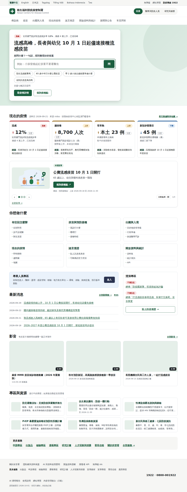 | 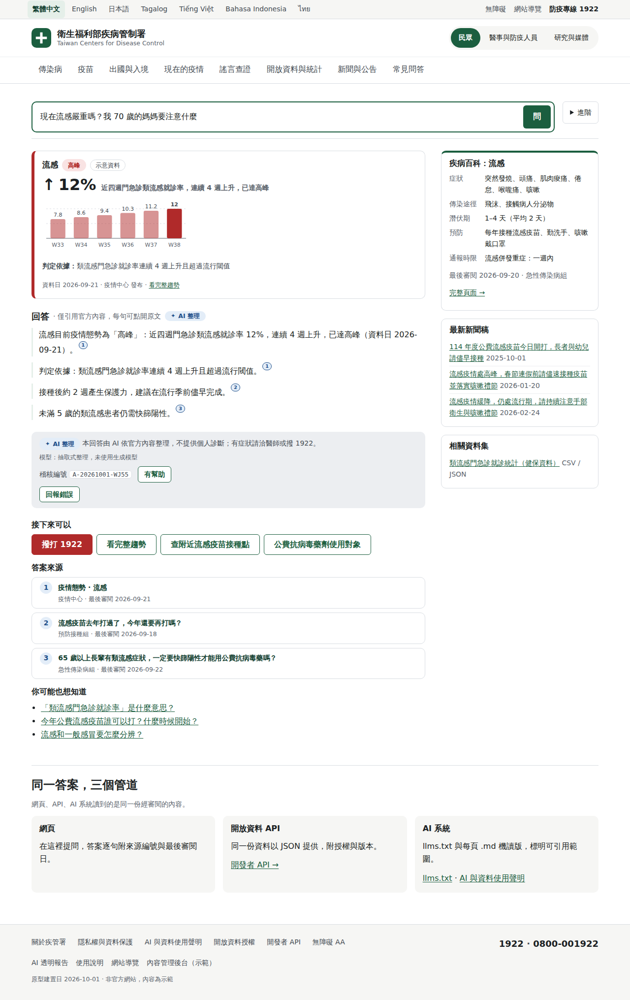 |

| 疾病頁（八區塊＋一分鐘重點＋三層露出） | 失效版文件（自動警示、noindex、版本鏈） |
| --- | --- |
| 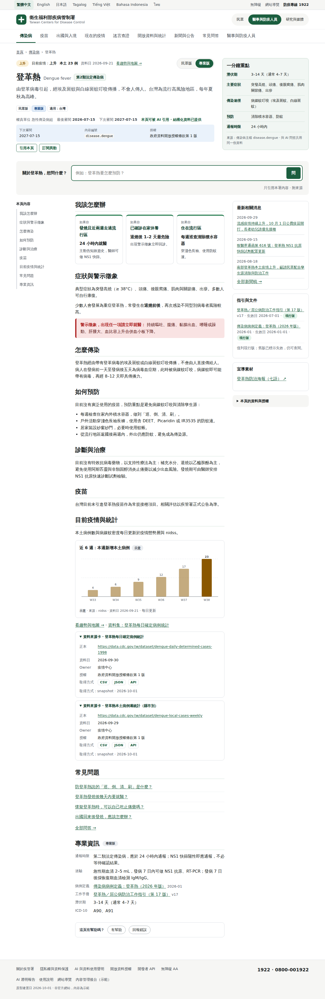 | 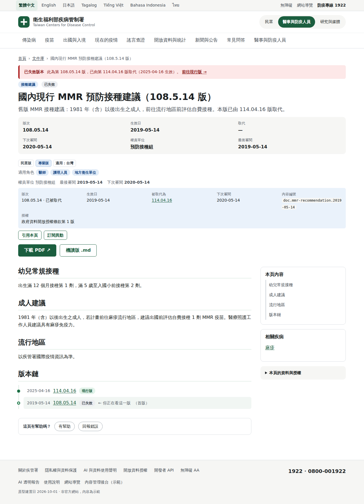 |

| 專業人員專區 | 後台：連動待辦（MMR 事件自動產生） |
| --- | --- |
| 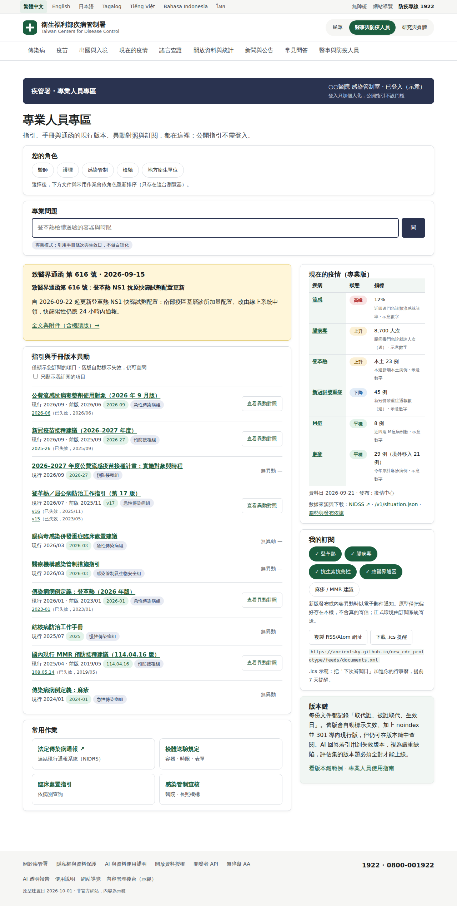 | 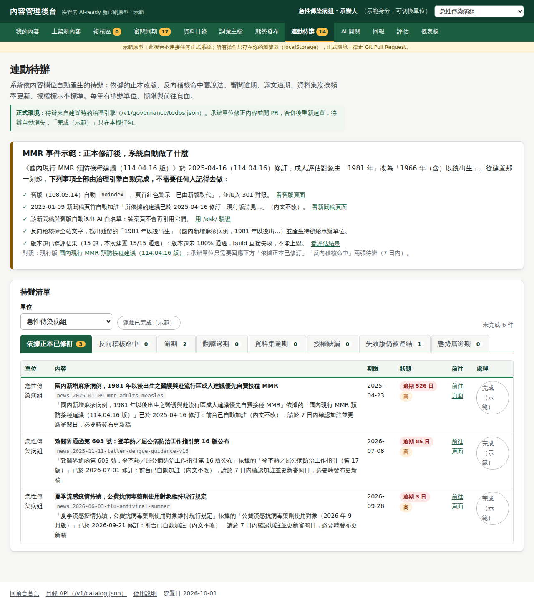 |

| 影音頁：過時影片自動加註（MMR 事件） | 通報專區：時限表由主檔自動產生 |
| --- | --- |
| 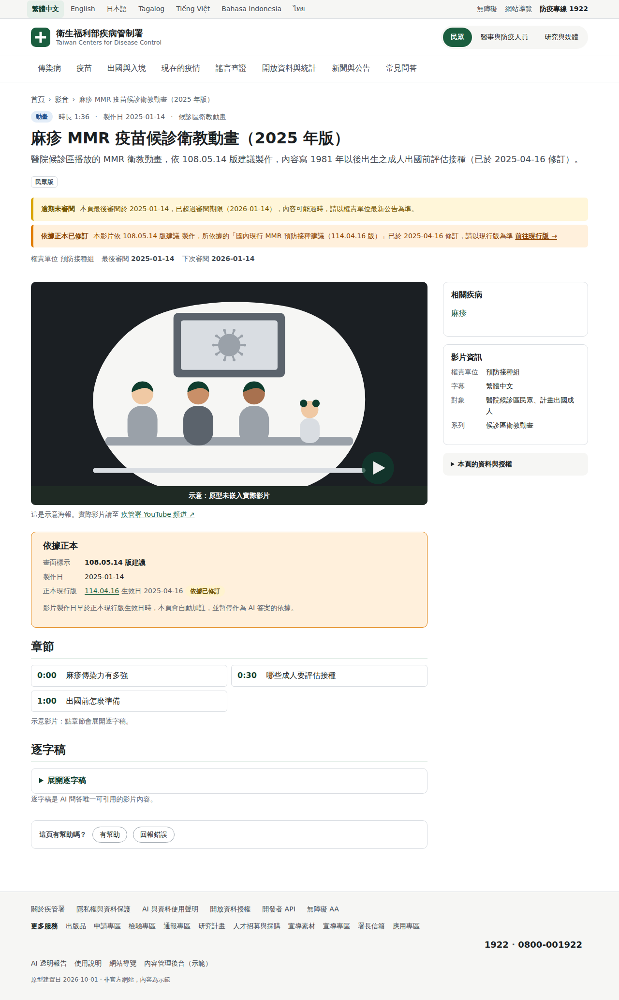 | 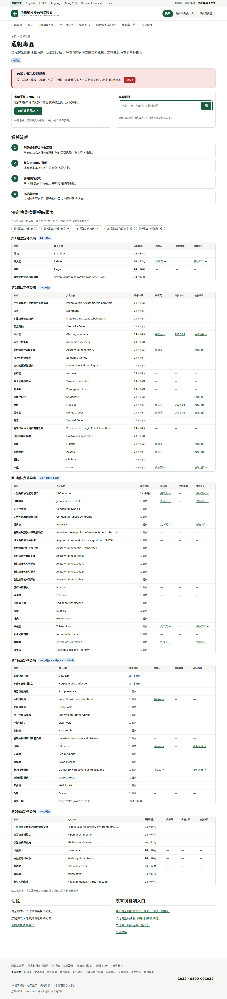 |

| 關於疾管署：組織圖自主檔產生 | 宣導專區：Banner 有權責與上下架 |
| --- | --- |
| 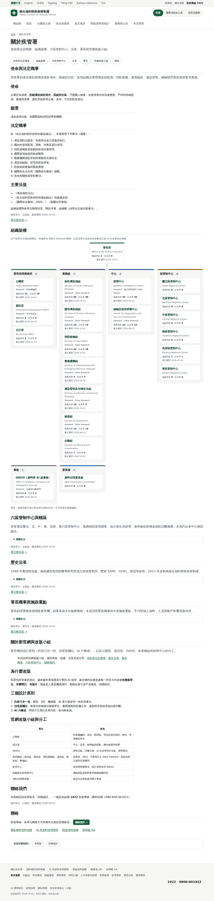 | 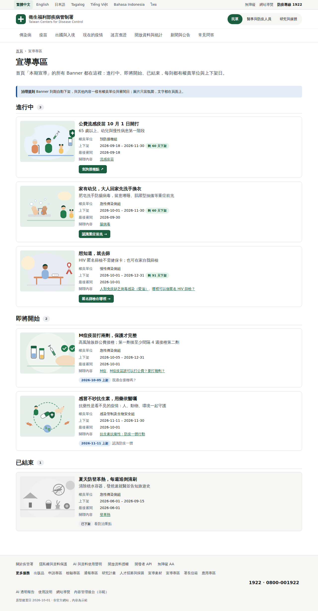 |

更多：[治理儀表板](docs/screenshots/admin.png)、[手機首頁](docs/screenshots/home-mobile.png)、[越南文首頁](docs/screenshots/home-vi.png)。

## 這個原型示範什麼

1. **治理是欄位，不是另一個系統。** 每筆內容必填權責單位、最後審閱日、審閱週期、對象、狀態、授權。缺一個，建置失敗，上不了線。
2. **人只填一次，機器算其餘。** 下次審閱日、逾期、失效版本、衍生內容待辦、AI 白名單資格、翻譯是否過期、KPI、季報，全部由欄位在建置時推導。
3. **AI 只轉述、不創作。** 預設答案引擎是「抽取式」：每句話就是白名單內容的一句原文並附來源編號；可選接 LLM（自備金鑰），輸出每句必須對得到檢索片段，對不上就刪。

## 規模與功能清單

- **規模**：內容 300 筆（疾病、疫苗、FAQ、新聞與公告、文件、澄清、資料集、影音、專區、申請服務、出版品、檢驗項目、研究計畫、職缺、標案）；七語靜態頁 2,605 頁（含 231 個目的地頁）；後台 18 頁；評估集 195 題（版本題 19）；治理測試 357 項。
- **內容型別（16 種）**：疾病、Q&A、新聞稿／通函／澄清、文件（版本鏈）、疫苗、資料集、Banner、一般頁，加上第二輪新增的**影音、專區、申請服務、出版品、檢驗項目、研究計畫**，以及第七輪獨立出的**人才招募（`job`）、採購公告（`tender`）**。
- **民眾端**：一句話提問、六任務、疫情態勢、疾病與疫苗、旅遊、謠言查證、影音庫、專區、申請專區、公告、署長信箱。
- **專業端**：版本異動對照、檢驗專區、通報專區（時限表自動產生）、研究計畫、出版品、訂閱。
- **後台**：上架預處理（十五種型別，含發布車道徽章、排程與緊急發布、模擬送出）、複核、審閱到期、資料目錄（含影音、專區、申請、出版品、檢驗、研究）、**公告管理、影音管理、外部連結健康**、連動待辦（含影音過時、無逐字稿、連結失效、檢驗不一致）、疫情發布、AI 開關、評估、儀表板。
- **出國與入境（第四輪）**：以目的地為主：231 個國家／地區各有目的地頁（針對性等級、持續時間、長期建議標籤、旅程三階段建議由疾病主檔規則生成、該國近 30 天疫情資訊）；`/travel/` 依序為查目的地、近 30 天變化、世界地圖（三級三色、點國家進頁）、全球背景提醒、針對性等級表；API 新增 `/v1/country-changes.json`、`/v1/country-background.json`。
- **新增的自動化**：公告截止自動標示並退出首頁；影片製作日早於正本現行版生效日自動標過時；逐字稿參與反向稽核；外部連結每日 `npm run fetch -- --check-links` 檢查，失效自動變待辦；通報時限表由主檔產生。

## 第五輪：舊網址不 404，結核病專區移轉示範

舊網站的內容不會因為改版而不見，舊網址也不該變成 404。第五輪用**結核病專區**走完一整套「舊頁 → 新頁」的流程，做法可以套到其他 98 種疾病與所有欄目：

- **移轉清單**：`content/migration/tuberculosis.json` 逐筆列出舊頁（標題、舊網址、類型）、處理方式（已移轉／已併入／已封存／待確認／已移除）、對應的新內容與段落。權責單位在後台 `/admin/migration/` 逐筆確認（`verified`）；舊網址 ID 取不到者以 `{id}` 佔位，確認時補上。
- **新擺法、新要求**：結核病疾病頁加上專區導覽（民眾／專業各一套），指引與手冊走文件版本鏈，另有 Q&A、專區、補助與潛伏結核感染治療服務；頁首治理列有「本頁取代舊網站 N 個頁面」，展開看每筆舊網址與移轉後新增的治理要求。
- **舊網址不 404**：建置自動輸出 `v1/redirects.json`、`v1/legacy-map.json`，以及三種伺服器轉址檔 `redirects/nginx.map`、`redirects/web.config.rewritemap.xml`、`redirects/_redirects`；404 頁自動帶往新頁，`/legacy/` 可貼舊網址查新頁。靜態主機的 404 頁只是示範與備援，**正式站必須由伺服器回 301**。
- **上線後監測**：`node scripts/analyze-404-log.mjs access.log --map dist/v1/legacy-map.json --migration content/migration` 把 404 log 分成「可直接 301」「待補對照」「真的不存在（建議 410）」三類，待補對照附可貼進清單的草稿。
- **規劃回補**：整理了 39 項「規劃文件沒寫到、原型做了」的作法，見 [docs/plan-supplement.md](docs/plan-supplement.md)（第 29–39 項為後四輪新增）；完整移轉與轉址手冊見 [docs/migration-playbook.md](docs/migration-playbook.md)；同事操作步驟見 [docs/guide-staff.md](docs/guide-staff.md) 第 15 節。

> 限制：開發環境連不到 `www.cdc.gov.tw`，結核病專區的舊頁清單依規劃文件的 URL 模式重建，每筆標 `verified: false`，等權責單位確認。

## 第六輪：移轉套用到全部疾病、國際合作區塊、內容來源語言

第五輪證明「一個專區走完整套」可行；第六輪回答「99 種疾病怎麼辦」，並補上舊站只有英文版的國際合作區塊：

- **移轉套用全部疾病（推導清單 → 只寫例外）**：舊站每個疾病頁的子頁結構相同，所以標準子頁樹寫成一份模板 `content/migration/_disease-template.json`，治理引擎對主檔**每一種疾病**推導一份移轉清單（原型主檔 72 種：16 種已有疾病頁，其餘標 `no-page`）；有疾病頁且新站有對應內容就算已移轉／已併入，沒有就是待移轉。人工清單**只寫模板沒有的例外**（疾病特有專區頁、專屬指引與公告），同 `key` 覆蓋推導結果。待辦每份清單只開一則，優先度依法定類別。結核病之外，登革熱、流感、麻疹、腸病毒也回補了防治計畫（`professional.programs`）、文件、Q&A 與例外清單。後台 `/admin/migration/` 看 72 份清單進度，`/v1/migration/{slug}.json` 可下載當人工清單的起點。
- **國際合作區塊**：舊英文站的 International Cooperation 移到新站（IHR 國家聯絡窗口、多邊與雙邊合作、國際訓練與申請、英文出版品與新聞），入口為 `/international/`，主選單不增項，放在研究與媒體入口與頁尾。
- **內容來源語言 `sourceLang`**：國際合作內容以**英文為來源語言**、中文為必備的審核譯文：頂層欄位是英文，中文放 `i18n['zh-TW']`；缺中文譯文建置失敗；頁首標示「本頁以英文為準，中文為譯文」。逾期、譯文過期、白名單等治理規則照常運作。
- **規劃回補與手冊**：[docs/plan-supplement.md](docs/plan-supplement.md) 新增第 29–31 項（推導清單、sourceLang、國際合作雙語）；[docs/governance-model.md](docs/governance-model.md) 新增規則 17、18；[docs/migration-playbook.md](docs/migration-playbook.md) 新增第 10 節「規模化：99 種疾病怎麼做」；[docs/guide-staff.md](docs/guide-staff.md) 第 15 節改為「推導清單 → 只寫例外」流程。

> 限制：推導清單的舊網址一律以 `{id}` 佔位（標 `pattern`），不進伺服器轉址檔；要讓 301 真的生效，需向資訊室取得舊站 ID 對照（見 playbook 第 10.5 節）。英文站 `/En` 同樣連不到，國際合作的舊頁清單依既有認識重建，全部 `verified: false`。

## 第七輪：人才招募與採購公告分家、招募生命週期、模擬報名

第二輪把人才招募與採購公告放在新聞稿底下，只有一個截止日。第七輪把兩者拆開，各有權責單位與自己的生命週期：

- **人才招募與採購公告分家**：人才招募成為獨立的 `job` 型別（`/careers/`，權責**人事室**，新單位 `unit.personnel`），採購公告成為 `tender` 型別（`/procurement/`，權責秘書室）。`news` 不再有招募與採購兩種；舊 `/news/{slug}/` 網址 301 到新路徑。頁尾「更多服務」也拆成「人才招募」「採購公告」兩個入口。
- **招募生命週期（日期推導，不靠人記）**：即將開放 → 報名中 → 已截止 → 審查與甄試中 → 結果公布 → 90 天後進歷史；人工只有「取消」「已補實」兩種覆蓋。職缺頁有**時間軸**標示目前階段，已截止頁寫明「結果預計 {日期} 公布」。三個待辦：結果逾期、備取將到期、外部報名網址失效。備取名單過有效期後自動不顯示。
- **模擬報名「不送出任何資料」**：`/careers/{slug}/apply/` 是三步驟的示範表單（即時驗證、草稿、收執可列印、可下載 JSON 與 `.ics`），**資料只存在你的瀏覽器 localStorage，不送出任何資料**，頁面明示為原型示範。正式站的報名系統在站外或後端（職缺填 `applyUrl`），本站只公布職缺、時程與結果。
- **個資遮罩閘門**：甄選結果與遞補公告只公布**報名編號與遮罩姓名**；`nameMasked` 必須含遮罩字（○）且不得有完整姓名樣式、`candidateNo` 不得像身分證字號、正取數不得超過名額，**違反即建置失敗**。AI 白名單排除名單，答案引擎問「誰錄取」只給結果頁連結。
- **採購公告狀態化**：招標中 → 已截止 → 已開標 → 已決標（或流標、取消），決標逾期自動開待辦；本站只做入口與狀態，**正式公告以政府電子採購網為準**。
- **文件**：[docs/careers-privacy.md](docs/careers-privacy.md)（招募個資處理原則）；[docs/guide-staff.md](docs/guide-staff.md) 新增第 16 節（人才招募 SOP，人事室）與第 17 節（採購公告 SOP，秘書室）；[docs/governance-model.md](docs/governance-model.md) 新增規則 19–21；[docs/plan-supplement.md](docs/plan-supplement.md) 新增第 32–34 項；[docs/migration-playbook.md](docs/migration-playbook.md) 新增 10.8「欄目型清單：人才招募、採購」。
- **輸出**：`/v1/jobs.json`、`/v1/tenders.json`（含階段）、RSS `feeds/careers.xml`、`feeds/procurement.xml`、JSON-LD `JobPosting`；後台 `/admin/jobs/`（人事室：職缺與階段、待辦、結果上架檢核）、`/admin/tenders/`（秘書室）。

> 限制：連不到 `www.cdc.gov.tw`，舊站「人才招募」「採購公告」欄目的移轉清單（`content/migration/careers.json`、`procurement.json`）依既有認識重建，全部 `verified: false`。示範資料中的職缺、錄取名單（報名編號與遮罩姓名）與決標廠商皆為虛構，不可當作真實公告引用。

## 第八輪：上架功能補完：所見即所得編輯、附件與圖片的放法

前幾輪的上架流程要同事「貼 Markdown、手寫附件網址」。第八輪補上兩個缺口：不會 Markdown 的人怎麼寫內文，以及附件與內文圖片放哪裡、建置時檢查什麼。**正本仍是 Markdown＋JSON**（可 diff、可機讀、可給 AI），所見即所得只是輸入方式。

- **三頁籤內文編輯**：`/admin/publish/` 內文欄有**所見即所得／Markdown／預覽**三個頁籤，同一份資料、即時轉換；工具列有標題、粗斜體、清單、連結、表格、圖片、引用；貼上 Word 或網頁內容時自動清成支援的子集。**存檔一律是 Markdown**。
- **附件與圖片面板**：拖放多檔；檔名自動正規化（中文檔名要自己改）、選 `kind`（附件／內文圖片／資料檔）、填 label 與 alt、授權與來源、PDF 是否有文字層、算 SHA-256；一鍵把圖片插進內文。
- **上架包**：「產生上架包」下載 **ZIP**（內含 `content/{型別}/{id}.json` 與 `content/assets/{id}/…` 原檔），畫面列出放哪裡與 PR 指引；解壓到 repo、開 PR、CI 檢查即可。
- **檔案放哪裡**：`content/assets/{內容 id}/` → 公開網址 `/files/{內容 id}/{檔名}`（七語共用，不帶語言前綴）；內容用 `assets[]` 宣告每個檔。檔名只能小寫英數、連字號、底線與點。
- **建置閘門**：檔案存在、`sha256`／`bytes` 相符、格式與大小在限制內（PDF ≤ 20 MB、圖片 ≤ 2 MB、資料檔 ≤ 50 MB）、SVG 無腳本、內文 `/files/` 引用都有宣告；**圖片沒有 alt 或授權直接建置失敗**；孤兒檔開待辦。hash 不符時訊息印出實際值，`npm run build -- --fix-assets` 可自動補寫 `bytes`／`sha256`／`mime`／寬高。
- **PDF 可及性**：PDF 沒有文字層又沒附 `.md`／`.docx` 替代版 ⇒ 待辦 `attachment-no-accessible-version`。
- **文件**：[docs/assets-policy.md](docs/assets-policy.md)（新）；[docs/guide-staff.md](docs/guide-staff.md) 第 2 節重寫為完整上架 SOP（三種編輯方式、附件與圖片、上架包、常見錯誤）；[docs/governance-model.md](docs/governance-model.md) 新增規則 22–24 與共同欄位 `assets`；[docs/plan-supplement.md](docs/plan-supplement.md) 新增第 35–36 項；ARCHITECTURE §16。

> 限制：原型的建置檢查不做**病毒掃描**與**個資偵測**，PDF 文字層只有簡易偵測（宣告 `machineReadable: true` 卻偵測不到時警告；標籤與閱讀順序無法判斷，`machineReadable` 是承辦人聲明，由複核者抽查）；這些列為正式站待辦，見 [docs/assets-policy.md](docs/assets-policy.md) 第 10 節。範例檔案皆為本輪由 `scripts/gen-sample-assets.mjs` 產生的示意檔。

## 第九輪：發布車道與自動合併、預覽網址、預定與緊急發布、舊站匯出批次轉換

目標：承辦人感受到的流程**跟舊後台一樣簡單**（登入 → 選型別 → 填標題 → 貼內文 → 拖附件 → 送出，一樣 6 步），治理在背後自動發生；並示範舊站匯出一鍵轉成內容草稿。原型沒有後端，所以後台的「送出」是**模擬**（產生上架包 → 開 PR 的時間軸展示），**但 PR 之後的一切在 GitHub Actions 上真的會跑**。

- **三條發布車道**（`content/governance/lanes.json`，由系統依型別判定）：**快車道**（新聞稿、通函、澄清、職缺、採購、Banner）CI 通過就自動合併，約 3 分鐘上線，公關室 24 小時內複核；**一般車道**（疾病、疫苗、文件、Q&A、專區…）CI 通過還要 1 位審核人核准（疾病與疫苗為公關室＋OASIS），SLA 2 個工作天；**緊急發布**（疫情態勢，以及標了 `urgent` 的新聞稿／通函／澄清）10 分鐘內上線。一個 PR 含多種內容時取最嚴格的車道。**CI 是第一位審核者**；多語不擋中文。
- **後台 `/admin/publish/`**：型別一選就顯示**車道徽章**與一句說明；新增「**排程發布**」（`publishAt`，臺北時間）與「**緊急發布**」（`urgent`，只對新聞稿／通函／澄清顯示）；預檢加「urgent 只能用於允許型別」「`publishAt` 必須晚於現在」；預處理結果最下面「**模擬送出**」展開時間軸：建立分支 → 開 PR → CI 檢查（schema、治理規則、評估集、檔案資產、連結）→ 車道判定 → 自動合併／等待審核（列審核人與 SLA）→ 部署 → 預覽網址，每步附「正式環境由系統代做」。模擬送出**不呼叫任何 API**。

  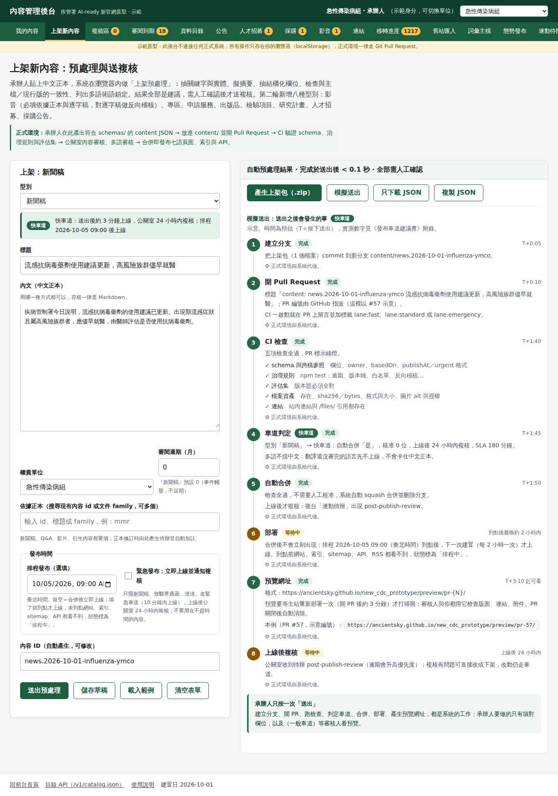

- **PR 預覽網址**：每個 PR 有專屬預覽 `https://ancientsky.github.io/new_cdc_prototype/preview/pr-{N}/`（`previews` 分支，主站部署時複製進 `dist/preview/`），PR 關閉自動清除。**預覽目錄在 GitHub Pages 上是公開的**，只能示範，正式環境必須放內網或加存取控制。
- **排程發布與上線後複核**：`publishAt` 未到點的內容不渲染、不進索引、sitemap、API、RSS、`llms.txt`（以真實時間判斷，不受 `BUILD_TODAY` 影響）；主站改為**每 2 小時重建**，到點後最晚 2 小時內上線。快車道與緊急發布的內容上線後，治理引擎自動開 `post-publish-review` 待辦（公關室，24 小時內，逾期升為高優先）。
- **工作流程**：`content-pr.yml`（檢查、車道判定、預覽、PR 留言與標籤、自動合併）、`preview-cleanup.yml`、`lane-sla.yml`（逾期加 `sla:breach`）、`pages.yml`（每 2 小時）；`.github/CODEOWNERS` 以註解標示單位對應。`node scripts/lane.mjs <變更檔案…>` 可在本機試車道判定。
- **舊站匯出批次轉換**：`node scripts/import-legacy.mjs <匯出目錄> --out <輸出目錄>` 讀舊站匯出（每頁 `.html`＋`.json` 側檔），依規則檔 `content/migration/import/_import-rules.json` 轉成內容**草稿**（`status: review`、信心 0–1、問題清單）、搬附件並宣告 `assets`、輸出批次報告與移轉清單更新建議；信心 < 0.6 一定人工檢視；後台 `/admin/import/` 看報告。第一批實測是結核病 40 個舊頁（**模擬匯出**，整合者補實測數字）。
- **文件**：[docs/publishing-lanes.md](docs/publishing-lanes.md)（**建議書**，給主管與各單位：問題、原則、車道表、時程、預覽、預定與緊急、複核、權限、SLA、試行計畫、按鍵數對照、風險）；[docs/legacy-import.md](docs/legacy-import.md)（匯出格式、規則檔、信心分級、三級處理、結核病首批）；[docs/guide-staff.md](docs/guide-staff.md) 第 2.8、2.9 節與第 15.14 節；[docs/governance-model.md](docs/governance-model.md) 新增規則 25–27 與欄位 `publishAt`、`urgent`、`postPublishReview`、`conversion`；[docs/plan-supplement.md](docs/plan-supplement.md) 新增第 37–39 項；[docs/deploy.md](docs/deploy.md) 補工作流程與注意事項；ARCHITECTURE §17。

> 限制：(1) 後台的「送出」是**展示**，原型不能代承辦人開 PR，交件仍是下載 ZIP；(2) GitHub 工作流程**無法在本機驗證**，是否如預期運作以開一個真實測試 PR 的結果為準（見 [docs/publishing-lanes.md](docs/publishing-lanes.md) 附錄 B）；(3) 排程發布受每 2 小時重建限制，延遲最多 2 小時；(4) 開發環境連不到舊站，結核病首批用的是**依既有內容反推的模擬匯出**，真實匯出的版型與品質可能不同，規則要用真實樣本校準。

## 第四十八輪：grokbot 第三批 13 個 issue（#93–#105）——換句話就答錯、待確認沒標、倒數算死、外語介面沒翻

grokbot 以民眾、校護、長者、移工等人設再測一輪（2026-10-14），開了 13 個 issue。全部在 main 上重現（沒有一個是誤報或已修），分四路平行處理後合併：答案引擎（#93、#94、#95、#96、#101、#102）、內容（#95、#96、#101）、介面與無障礙（#97、#98、#99、#100）、基礎設施（#103、#104、#105）。各路的細節與理由分別在 [docs/ask-search-llm.md](docs/ask-search-llm.md) 第 13 節、[docs/guide-staff.md](docs/guide-staff.md) 第 46–47 節、[docs/a11y.md](docs/a11y.md) 第 9–10 節、[docs/i18n.md](docs/i18n.md) 第 7 節、[docs/deploy.md](docs/deploy.md) 15.3 與第 17 節；工程契約在 ARCHITECTURE §51，取捨在 architecture-decisions §36。

### 做了什麼

- **待確認的內容在答案裡也要看得到（#93）**：引用 `verification.status: pending` 內容的句子句尾加「（待確認）」、來源卡摘要列加「內容待確認」標籤——和時程表句子一致。建置另列出「待確認但審閱日等於建立日」的內容（目前 19 筆，只警告）。
- **換個說法也要答對（#94）**：問句裡只屬於少數幾份內容的詞（鼬獾、呼吸道融合病毒、補接種…）變成「主題錨點」，錨定的片段優先；「晚了才打」「打過什麼疫苗去哪查」兩種口語補進改寫規則；「去哪裡查」先分清受詞是紀錄還是疫苗。每則被改到的 FAQ／服務在評估集各加 3–5 種民眾說法（R48-01～36）。
- **指名的疫苗不能用近親頂替（#95）**：問「皮蛇疫苗」時站上若沒有任何片段提到它，直接說「本站尚無帶狀疱疹疫苗專頁，請撥 1922」並附時程表連結，不再拿水痘疫苗回答。同時新增帶狀疱疹疫苗頁與「是公費嗎」FAQ（待預防醫學辦公室確認）。
- **「但…」開頭的句子不再單獨出現（#96）**：連接詞開頭的句子，前一句也選入就接成一句，否則不選。新增「學校多人得流感要停課嗎」FAQ（急性傳染病組待確認，所有門檻都放在待確認清單，不寫成事實）。
- **切題就不標「相關程度較低」（#102）**：門檻不動，改判斷——第一句出自同一疾病的 FAQ／片段、且問句與片段在同一面向（費用、就醫、疫苗…）就視為切題。評估集新增 `lowRelevance` 期望值。
- **外語回退一致（#101）**：印尼、泰、菲律賓語問登革熱症狀、被狗咬，現在都回到中文原文並加說明，不再一下答、一下查無；詞彙多語名與疾病主檔別名用來對應主題。狂犬病咬傷與結核病費用 FAQ 補了 id／th／tl 機器初稿進審核隊列（依既有政策：機器翻譯會顯示並標「機器翻譯」，不進答案索引）。
- **「剩 N 天」改由瀏覽器算（#97）**：HTML 保留建置時文字與絕對日期當無 JS 備援（`data-deadline`），有 JS 時依瀏覽器當天（台北日界線）重算；後台表格註明「以建置日計」。
- **放大 200% 不橫向捲動、標題不跳級（#98、#99）**：採購公告側欄、問答框、訂閱格、首頁格子改成可縮可換行；`npm run a11y` 新增「文字 200%／390 px」視窗並把橫向捲動列為阻擋，頁面清單加入採購與招募；頁籤的列印用 h2 改為讀屏可讀，axe 不再回報 heading-order。
- **答案頁介面七語齊備（#100）**：約 150 個字串搬到 `src/client/i18n.ask.js`，依語言拆檔只給答案頁載入；「（另開視窗）」、來源卡單位名稱改走 i18n（英文頁顯示單位英文名）；疫情卡語言欄位不齊時整張改英文；`/<lang>/` 與 `/<lang>/ask/` 的中文比例超標改為建置失敗。
- **專業版資料也要有預算（#103）**：專業版答案資料另訂 565 KB 預算（489 KB × 1.15），超過即建置失敗；`npm run perf:ask` 實測寫進文件；主題分片評估後**暫不做**（省約 20–25% 傳輸但 TBT 幾乎不變），先做便宜的兩步。
- **人工走查腳本（#104）**、**Node 22 宣告（#105）**。

### 為什麼這樣做

- **修判斷不降門檻**：把 `lowBelow` 從 0.6 降到 0.5 也能讓這三題不標低相關，但會讓真正離題的答案也不標。切題判斷看的是「第一句出自哪裡、問的是不是同一面向」，離題答案過不了。
- **錨點只取自問句，不取詞彙展開**：若把詞彙主檔展開後的所有同義詞都當錨點，常見詞會造出假錨點，反而把對的片段擠下去。
- **近親疫苗寧可說沒有**：答成水痘疫苗是誤導；「本站尚無專頁」加 1922 是誠實的答案，也讓缺口進入待辦。
- **倒數不能算死**：靜態站的「剩 N 天」從建置那天起每天都少算；絕對日期永遠正確，倒數是加值，所以 HTML 放絕對日期、JS 才算倒數。
- **JS 預算差 0.6 KB 仍守住**：這輪引擎加規則一度 243.8 KB，靠「拒答文案依語言拆檔」與「答案頁字串搬出 render.js 依語言拆檔」壓回 238.4 KB——使用者只下載自己語言的字串，是正確的方向而不是權宜。

### 怎麼驗證

`tests/round48-engine.test.mjs`、`round48-ui.test.mjs`、`round48-ask-i18n.test.mjs`；評估集 326 題全過（含 R48-01～36）；`npm run a11y` 三種視窗 0 阻擋；建置 JS 預算 238.4／240 KB。合併四路工作後重跑了全部 26 個 grokbot 問句並逐題核對。

> 限制：仍沒答好的——「被鼬獾咬」答的是疫情說明不是處置步驤；印尼、泰文「登革熱症狀」答的是警示徵象；中文「被狗咬了怎麼辦」第二句仍引用蛇咬。ja／tl／vi／id／th 的答案頁字串與倒數字串為機器初稿。NVDA／VoiceOver 實機走查與標章申請仍待同事執行（腳本在 a11y.md 第 9 節）。

## 第四十七輪：主選單要不要 mega menu？不要整面的，加三個點擊展開的小面板

Yulun 問（2026-10-13）：現行官網是 mega menu，新原型的主選單要不要也做？評估結論是**不要照搬那種滑鼠移過去展開整面的**；但 mega menu 沒有退流行，只是做法換成「點擊展開、每項最多 9 個連結、手機改手風琴」。Yulun 核准後這一輪實作了最小版本。完整評估與設計理由見 [docs/navigation.md](docs/navigation.md)，工程契約 ARCHITECTURE §50，無障礙對照 [docs/a11y.md](docs/a11y.md) 第 8 節。

> 註記：現行 cdc.gov.tw 的選單結構是從搜尋快取與衛福部頁面推斷，沒有直接連線確認，項目數與順序請以官網為準。

### 做了什麼

- **主選單仍是八項扁平**，只在「傳染病、疫苗、出國與入境」三項旁邊加一個 ▾ 鈕，點了展開一個小面板（兩欄，4–9 個連結，最後一個永遠是「前往○○專區 →」；傳染病面板的疾病最多 4 個，因為 4 + 欄二 4 個 + 前往專區 = 9 的上限；疫苗面板略過本語言沒有版本的項目，外語頁選單才不會夾雜中文）。疫情、闢謠、資料、新聞、常見問答五項不變。
- **手機**併入既有的「選單」面板，面板變成手風琴（在文件流中展開，不浮動）。
- **內容不另維護**：疫苗面板與 `/vaccines/` 的 `.vx-hub` 共用同一個函式；傳染病面板依序取「目前疫情」對應的已發布疾病頁（不足才補最新審閱的）；出國面板只連到 `travel.mjs` 真的輸出的錨點（沒有獨立的疫情列表路由，列表就是 `#tv-nw-h` 區塊，所以不另放連結）。
- **七語齊備**，後台不受影響。

### 為什麼這樣做

- **用 `<details>/<summary>`，不自己寫 button**：無 JS 也能開合，鍵盤與讀屏原生支援，與第二十四輪手機語言選單同一套；JS 只做 Esc、點外面關閉、一次只開一個（ui.js 原始碼增加 1,057 bytes，建置後 20.5 KB；公開頁 JS 最大 64.5 KB，預算 120 KB）。`focusout` 只在焦點確定移到面板外時才關，否則點面板內的純文字就會把面板收起來。
- **不 hover**：觸控與鍵盤沒有 hover、滑鼠誤觸會遮內容、WCAG 1.4.13 最常失分；CSS 裡不准有 `:hover` 開面板的規則，測試會掃。
- **內容由資料推導**：選單與入口頁不同步是最常見的壞法；錨點被改掉時建置就失敗，不會變成悄悄壞掉的連結。
- **每面板 ≤ 9 個**：再多就是把網站導覽頁塞進頁首。
- **一個 CSS 陷阱**：`.c-nav__in` 有 `overflow-x:auto`，面板若定位在它裡面會被裁掉；所以面板的 containing block 設在 `.c-nav`，各層 item／details／summary 都不設 `position:relative`。

### 怎麼驗證

`tests/round47-nav-panels.test.mjs`（9 個測試）：七語首頁各恰好 3 個 `details[data-nav-dd]`、summary 無 `aria-*`／`role`、面板 id 唯一、每面板 4–9 個連結且全部指向存在的輸出檔與錨點、疫苗面板每個連結都在 `.vx-hub` 內、傳染病面板依序含目前疫情的已發布疾病頁且 ≤ 4、`/pro/` 與 `/` 都含 `c-pro-only` 連結、面板內沒有標題、base.css 無 hover 規則與定位正確、ui.js 含 `data-nav-dd`／`Escape`／`focusout`、後台不含 `data-nav-dd`；Playwright 端到端（1280px 點開／換開／Esc 焦點回 summary／點外面關；390px 手風琴在文件流中；開面板後 axe 無 serious／critical；沒有 dist 或 chromium 時略過；另驗證面板沒被 overflow 裁切（`elementFromPoint`）與手機版面，axe 在 1280px 開傳染病面板後掃整個首頁）。`tests/round6-ui.test.mjs` 計算選單連結前會先去掉 details 區塊。

> 限制：面板內容的挑選規則（例如疫苗面板只取每群第一筆）是編輯判斷，可在使用者測試後調整；現行官網結構為推斷；尚未用 NVDA／VoiceOver 實測。

## 第四十六輪：九份真實 PDF 的實測——作者、頁數、中英文篇名、表格都帶得進來

Yulun 回報（2026-10-13）：42(18) 上傳後**作者沒抓到、結尾頁數沒抓到、中英文篇名沒抓到、表格沒剖析**，並給了 8 份範例 PDF。這一輪九份全跑過、逐一修到能用：42(18) 五位作者、兩個單位、頁碼 168-180、中英篇名都帶入，**4 個表格還原成 Markdown 表格內容**（表一跨頁接回同一個表）。切段規則仍然只有一套。完整說明 [docs/bulletin.md](docs/bulletin.md) §14.7，同仁提醒手冊 §45.6，決策 [docs/architecture-decisions.md](docs/architecture-decisions.md) §35，工程契約 ARCHITECTURE §49.4。

### 做了什麼

- **九份樣本的結果**：新版 42(15)(17)(18)(19) 與焦點特寫全欄位帶入；2013 年整期合刊只帶第一篇並提醒改單篇；沒有篇名／作者的「國內外疫情焦點」以分類名代入。逐篇表格見 bulletin.md §14.7。
- **表格依座標還原**：儲存格為主、欄起點為輔；表頭上層、表下註解、(續上頁)／(接下頁) 都處理。
- **圖內文字略過**：向量圖的座標軸刻度不再污染正文，report 提醒確認圖檔。
- **更多版型**：全形星號與「1.2」上標、折成多行的篇名與英文篇名、舊版上標獨立成行、單一單位無編號、無章節標題、整期合刊。

### 本輪學到的

- **相容字（NFC）**：文字層給的「劉」是 U+F9C7（CJK 相容表意文字），肉眼相同但碼位不同，比對失敗；原始文字一律先 NFC。
- **旋轉的側標字**：頁邊直排字（旋轉 90°）會被讀成一般文字黏進行；跳過 transform 顯示旋轉的字塊。
- **隱藏的疊印文字**：42(17) 把看不見的「疫情描述」疊在單位名同一座標；丟掉完全落在別的字塊範圍內的字塊。
- **頁尾文字層可能缺字**：「疫情報 導」少了一個字，頁碼就推不出來；比對要容許缺字。
- **`SIDEBAR_RE` 會誤殺 Markdown 表格列**：丟側標的規則太寬，把 `| … |` 的列也吃掉；收窄到中間不可有空白。
- **`FIG_RE` 會把句子當圖說**：「圖二為…」是句子；中文數字後必須接「、」或空白才算圖說。
- **舊版整期合刊 PDF**：一份檔多篇文章，第二個「摘要」之後要切掉並提醒改單篇；舊版文字層逐字有空白（「8 ,2 4 5」），數字需人工清。

> 限制：2013 以前的 PDF 數字裡有空白；列名垂直置中的表折行值可能掛錯列；第一資料列折行會併進表頭；無編號「表、」只留在正文；掃描檔、向量圖、整期合刊只帶第一篇的限制不變。「依版面推測的標題」是猜的，要核對。

## 第四十五輪：《疫情報導》上傳 PDF 就自動帶入欄位、全文與圖，審批後直接上架

同事問（2026-10-13）：**能不能上傳疫情報導的 PDF，後台自動 parsing 成需要的欄位及全文，審批後上架，不要再人工逐一欄位填寫？** 可以，原型做出來了：PDF 拖進後台 → 欄位、全文、圖自動帶入（1 秒）→ 核對、檢核 → 「送審」→ 科長「核准上線」→ 文章、卷期、PDF、圖一起進正式庫。不填欄位、不打包 ZIP、不碰 Git。完整說明 [docs/bulletin.md](docs/bulletin.md) §14，同仁 SOP 手冊 §45。

### 做了什麼

- **瀏覽器端讀 PDF**：pdf.js（legacy 版，vendor 進 `src/public/vendor/pdfjs/`，只有後台用、用到才載入）讀文字層與內嵌圖片；PDF 不離開同事的電腦。
- **切段規則只有一套**：`pdf-manuscript.js` 把 pdf.js 的字塊依座標排回「一行一行」的版面文字（和 `pdftotext -layout` 同形），交給第三十五輪的 `splitManuscript`，一個字都沒改就把真實文章 42(19) 的篇名、7 位作者、單位、DOI、日期、關鍵字、分類、摘要、7 段正文、圖說、11 筆文獻、英文摘要全部帶入。
- **圖自動配**：抽出的圖依「圖 N」圖說所在頁配對，太小、重複的刊頭圖略過，配不到的列縮圖讓同事「當作圖 N」；配到的圖自動命名、算 sha256、宣告進 `assets[]`。同一份 PDF 自動成為「單篇 PDF」附件。
- **送審件帶附件與配套內容**：寫入閘道（第三十輪）的 `/drafts`、`/submit` 可帶 `files[]`（PDF、圖）與 `companions[]`（新的一期），同分支、同次核准、同一個合併上線；閘道用建置同一支 `validateAssets` 查附件的 bytes／sha256／內容，「後台通過＝CI 通過」在有附件之後仍然成立。上限整包 24 MB、附件 16 MB、20 個檔。
- **實測**（Chromium）：真實 PDF 上傳 → 全欄位帶入 → 存草稿 → 送審 → 科長核准 → `main` 多了文章、卷期、`fig-1.png`（與抽出的圖逐位元相同）、PDF（與上傳檔逐位元相同），提交有 `Edited-by`／`Approved-by`。
- **測試**：`tests/round45-pdf-gateway.test.mjs`（7 項）。

### 教訓

- **pdf.js 會轉移 ArrayBuffer**：讀完後原本的 bytes 變成空的，第一次實測送出去的 PDF 附件是 0 位元組；交出去前先複製。
- **vendor 用 legacy 版、檔名用 `.js`**：一般版用了很新的 `Map.prototype.getOrInsertComputed`，舊一點的瀏覽器整個載不起來；`.mjs` 在 IIS 等伺服器預設沒有 MIME，瀏覽器拒絕當模組載入。
- **讀 Git 裡的二進位檔不能經過字串**：本機 Git 供應者把 `cat-file` 輸出一律 `String()`，圖讀回來多了 80%，「不重傳附件再存一版」被自己的 sha256 檢查擋下。
- **刊頭的加寬字距**：「疫 情 調 查」在文字層裡字與字之間有空白，分類比對要先去空白。

> 限制：掃描檔（無文字層）讀不到字；向量圖抽不出來，同事仍要自己存 PNG；最多讀 60 頁；配圖是依頁的啟發式，縮圖與預覽的核對不能省。GitHub Pages 展示站沒有寫入閘道，第 4 步退回「產生上架包」。

## 第四十四輪：署長、副署長簡介——護欄會不會擋？不會，但要把「為什麼不擋」寫成規則

Yulun 問（2026-10-13）：現行官網有「署長簡介」「副署長簡介」，新站能不能做？擔心的是**第三十輪的個資護欄**（甄選結果不公布姓名、全庫個資掃描）會把首長的姓名擋下來、上不了架。

### 先回答擔心：護欄擋的是什麼、不擋什麼

| | 甄選結果的錄取人姓名（第三十輪擋） | 署長、副署長簡介（本輪放行） |
| --- | --- | --- |
| 是誰的資料 | 民眾（應考人）的個人資料 | 機關首長**在公務職位上**的資訊 |
| 公開的依據 | 沒有：公告目的只要「報名編號」就夠，姓名是多揭露 | 機關組織資訊本來就要主動公開；各部會官網都有首長簡介頁（衛福部首長介紹頁註明資料來源為人事處） |
| 內容 | 姓名、名次 | 職稱、姓名、學歷、證照、經歷、專長、正式照片 |
| 不可以有的 | 全部 | **出生年月日、籍貫、住址、配偶子女、私人電話與信箱**——那已超出職位，仍是個資 |
| 誰決定 | 人事室依簡章 | 秘書室依現行官網首長簡介逐字維護 |

所以答案是：**可以做，而且護欄不需要關掉**。本輪不是把首長檔案排除在掃描外，而是把「什麼叫公務簡介」寫成程式看得懂的規則，讓掃描器放行該放行的那一個姓名、同時把其他東西擋得比以前更嚴。全文見同仁手冊 §44（給秘書室）、ARCHITECTURE §48（給資訊室）、決策 §33。

### 做了什麼

- **內容**：`content/pages/leadership*.json` 四頁——總覽 `/about/leadership/`、署長 `/about/leadership/director-general/`、兩位副署長 `/about/leadership/deputy-director-general-1/`、`-2/`。**網址用職位、不用人名**，首長異動只改姓名與內文，網址、連結、RSS、搜尋索引都不變。每頁 `profile` 只允許職稱、姓名、英文名、任次、就任年月、照片、排序（schema `additionalProperties:false`，想加「出生日期」欄位會被 schema 擋）；學歷、證照、經歷、專長寫在內文四個 `##` 段落。中英文兩版；其他語言頁尾連到英文版。
- **內容來源與驗證狀態**：署長頁依現行官網「署長簡介」的搜尋摘要整理（第 6 任、2001 臺大醫學系、2016–2025 副署長、2025 迄今署長、專長感染症醫學與傳染病應用流行病學）；兩位副署長只有姓名（現行官網英文版列出）與一則媒體報導的經歷。開發環境連不到 cdc.gov.tw，三頁都標 `verification: pending`、來源 `verified: false`，頁首顯示「內容待權責單位確認」，待辦列給秘書室：逐字核對、補學經歷、提供正式照片與英文拼法。**沒有照片**時顯示占位圖與「照片待秘書室提供」。
- **關於頁與頁尾**：`/about/` 新增「首長簡介」區塊（三張卡片：照片、職稱、姓名），原「署長職掌與施政重點」保留並互連；頁尾「關於與政策」群組加「首長簡介」（七語）。
- **個資掃描**（`scripts/lib/pii-scan.mjs`）：`type: page` 且有 `profile` 的檔才算首長簡介檔；在這個檔裡 **person-name 只放行等於 `profile.name` 的那一個姓名**，內文提到別人照擋；手機、信箱、身分證規則完全不變；新增只對簡介檔生效的 `profile-private`——出現「出生、生日、住址、戶籍、籍貫、配偶、子女、家屬、血型、手機、私人信箱、婚姻、宗教、黨籍」就擋。沒有動白名單：**白名單不該變成人名清單**，首長換人時規則自動跟上。
- **後台**：上架表單新增「機關／政策頁」型別（slug、首長職位、姓名、英文名、任次、就任年月、排序、照片替代文字），秘書室從首長頁頁尾「同事修改這頁」進 `/admin/publish/?edit=page.leadership-director-general` 就能改；表單沒有的欄位（照片、`verification`）原樣保留，所以改內文不會讓「待確認」狀態消失，要由秘書室確認後改成 `confirmed`。新 API `v1/pages.json`（後台載入現行版用；首長簡介的 `profile` 也在裡面）。後台預檢會擋私人欄位詞與不在 `about/leadership/` 底下的 slug。
- **機讀**：首長頁 JSON-LD `ProfilePage` → `Person`（姓名、職稱、所屬機關）；`.md` 版帶職稱列；智慧問答可引用（白名單已申請核准），所以問「署長是誰」答得出來、且附來源。
- **測試**：`tests/round44-leadership.test.mjs`（7 項：內容與 schema、渲染、個資掃描三種情境、後台來回、dist）。

### 教訓

- **「放行」要寫成規則，不要寫成白名單**：一開始最省事的做法是把三個姓名加進 `pii-allowlist.json`。但那會讓白名單變成一份人名清單（本身就是個資的集合），而且首長換人時要有人記得去改。改成「簡介檔只放行自己的 `profile.name`」之後，規則對任何一任首長都成立，審核人也不必判斷「這個姓名為什麼可以」。比較好，因為規則可以測試、可以解釋，白名單只能相信。
- **放寬一處就要收緊一處**：放行姓名的同時加了 `profile-private` 檢查。各部會首長頁偶爾會抄進出生年月日、籍貫（Wikipedia 也有），新站一律不放——「與公務職位有關」是界線，寫進 schema、掃描器、後台預檢與同仁手冊四個地方，同一份清單（`PROFILE_PRIVATE`）。
- **網址用職位不用人名**：`/about/leadership/director-general/` 在首長異動時不變；用人名當網址，每次換人就多一個壞連結、少一段搜尋權重，還會留下前任的網址在搜尋引擎裡。
- **「不刊登姓名」的舊說法要一起改**：第一輪的署長職掌頁寫「不刊登個人姓名與照片」，當時是為了迴避個資問題；本輪把那句話改掉並連到首長簡介，否則兩頁會互相矛盾（第三十三輪的說法一致性檢查管的是數字，管不到這種）。
- **`/img/` 不加語言前綴**：首長頁的占位圖第一次建置在六個外語版的關於頁出現 404——照片網址要走 `imgSrc()`（`noLang`），和專區圖片同一條規則。

> 限制：(1) 三頁內容都**未逐字核對**（搜尋摘要、媒體報導），英文版經歷年份與中文版不同（英文官網分 2003–2006 住院醫師、2006–2008 感染科研究員），兩位副署長的學經歷與英文拼法待秘書室提供；(2) 沒有正式照片，顯示占位圖；(3) 首長簡介的法規依據（政府資訊公開法第 7 條機關組織資訊主動公開、個資法對公務機關執行法定職務之規定）是原型整理的理解，請法規會或個資窗口確認措辭；(4) 主任秘書頁 schema 已允許（`chief-secretary`）但本輪未建，秘書室要時從後台新增即可。

## 第四十三輪：國際疫情資訊從疫情中心資料庫自動上架

疫情中心同事問（2026-10-13）：他們有自己維護的資料庫，未來上架「國際重要疫情資訊」有沒有更聰明或自動化的方式？查下去發現，新站 `/travel/` 的「近 30 天國際重要疫情資訊」本來就是每天從現行官網 `TravelEpidemic/ExportJSON` 拉來的，而那個匯出檔的欄位（`sent`、`effective`、`headline`、`alert_disease`、`areaDesc`、`ISO3166`…）就是 CAP 格式——背後正是疫情中心的資料庫。所以答案不是另造一條路，而是**把今天隱含的格式寫成白紙黑字的契約，讓資料直接從中心資料庫進新站**。設計與契約在 [docs/intl-epidemic.md](docs/intl-epidemic.md)，工程契約 ARCHITECTURE §47，決策 [docs/architecture-decisions.md](docs/architecture-decisions.md) §32，同仁 SOP 在同仁手冊 §43。

### 四種做法，一句話比較

| 做法 | 一句話 | 結論 |
| --- | --- | --- |
| A. 後台表單（承辦人再填一次） | 兩個正本、抄錯漏登，等於叫中心多做一份工 | 只當**備援**（系統斷線時貼上） |
| B. 排程拉取（CI 向中心匯出端點拉） | 中心只給一個網址＋唯讀 token，今天的流程只是換掉 URL | **預設做法** |
| C. 推送（中心核定時 POST 到網站） | 分鐘級上線，但要開網路通路、管 token | **加值選項**，急件需要時再開 |
| D. 訂閱標準 feed（RSS／CAP XML） | RSS 會丟掉國碼與疾病對應；CAP XML 雙方都要寫 XML | 不另做；我們的 JSON 就是 CAP 欄位 |

**選定：一份契約＋ B 為主、C 為輔、A 為備援，三條路進同一個匯入器、同一套把關規則。** 網站端**不再加一道人審**——資料庫裡的那一筆已經是中心依既有流程核定的內容，網站該做的是機器把關與事後可見（待辦、匯入紀錄）。

### 做了什麼

- **交換格式 v1**（`schemas/intl-epidemic-feed.json`）：`{ version, producer, generatedAt, mode: full|delta, items[] }`，每則有穩定 `id`、`status`（published／updated／withdrawn，撤下只需 id）、發布／更新／下架時間、疾病、標題、內文、`areas[]`（國名、ISO 國碼、地區細節）。另接受等價的 **CSV**（一則一列、多國以 `;` 分隔）與**現行官網 ExportJSON 舊格式**，讓切換資料來源不必一步到位。
- **一個匯入器**（`scripts/lib/intl-epidemic.mjs`，CLI `npm run intl:import -- <檔案或 URL> [--dry]`）：讀入 → 驗證（schema＋白話錯誤＋個資掃描）→ 對主檔 → 比對上一版 → 寫檔。單則有錯只退回該則（網站保留它的上一版）；退回超過 20%、full 模式收到 0 則、或會讓清單少掉一半以上 ⇒ **整批保留不動**；與上次完全相同 ⇒ 不寫檔、不產生 commit。疾病或國家對不上主檔照常上架，但列待辦請中心補別名。
- **排程拉取接上**：`npm run fetch` 看 `INTL_FEED_URL`（＋`INTL_FEED_TOKEN`）有設就拉中心的 v1 feed，沒設維持官網匯出；兩者都經過匯入器。CI 從 secrets 帶入。今天的快照已用舊格式跑過一次匯入器重寫：既有欄位逐列不變，多了 `id`、`status`、`areas`、`body`、`diseaseId`、`provenance`。
- **推送端點與後台頁（規格，另一位同事同時實作）**：`POST /api/intl-epidemic`（Bearer token、≤ 2 MB、整批保留回 202），閘道 `POST /api/gateway/intl-epidemic/import`（登入＋CSRF，限疫情中心與跨單位管理角色，可先 dry 預覽），後台 `/admin/intl-epidemic/`（匯入狀態、退回與對不上清單、現行清單、歷史；貼上／上傳 JSON 或 CSV、單則表單 → 預覽 → 送出；沒有閘道就下載 JSON 交資訊室跑 `npm run intl:import`）。
- **前台**：每則有自己的頁 `/travel/alerts/{id}/`（內文、疾病頁與目的地頁連結、來源、七語骨架、JSON-LD、`.md` 機讀版）；`/travel/` 與目的地頁列表改連站內頁，原始網址改小字「原始來源」；新 RSS `feeds/travel-alerts.xml`（guid＝資料庫 id，更新不會變成新的一則），加入電子報訂閱主題。
- **待辦**：`intl-feed-held`（整批保留，高優先、1 天）、`intl-feed-unmapped`（對不上主檔，14 天），權責都是疫情中心。
- **測試**：`tests/intl-epidemic.test.mjs`（20 項）、`tests/travel-alert-ui.test.mjs`（11 項）。

### 教訓（全部 12 條在 docs/intl-epidemic.md 第 8 節）

- **新欄位先查誰在讀舊欄位**：原本想把 full／delta 記在快照 `meta.mode`，但 `/travel/` 已經用 `meta.mode` 判斷「即時／快照」；改記在 `meta.importMode`。比較好，因為前台的資料狀態標籤不會悄悄變錯。
- **真實資料比規格亂**：官網匯出有些列沒有疾病或國家欄位（例「美國-環孢子蟲病」），要從標題「國家-疾病」補；內文混有康熙部首字（⽐、⾮、⻑），主檔比對前要先 NFKC。不處理就會大量退回或對不上。
- **full 模式下被退回的那則不等於撤下**：原本「這批沒有＝撤下」，會讓一則因格式錯而從網站消失；改成保留上一版。比較好，因為資料有錯的代價不該是民眾看不到既有資訊。
- **內容指紋一改就是資料遷移**：改 `itemFingerprint`，下次匯入會全部變成「更新」，RSS 也跟著跳；要當資料遷移寫說明。
- **新增 RSS 頻道不只改一個檔**：訂閱主題清單、七語主題名、round28 測試的頻道數都要同步。

> 限制：(1) `data/samples/` 的範例是**示意資料、未驗證**；(2) 疫情中心資料庫的**真實 schema 未知**，v1 是我們提出的約定格式，要請中心回答 docs/intl-epidemic.md 第 7 節的問題後校準；(3) 開發環境**連不到 cdc.gov.tw**，快照的重寫以 repo 裡既有快照為準，拉取與推送都沒有對真實端點驗證過；(4) 現有快照有 7 個疾病名稱對不上主檔（沙門氏菌感染症、細菌性腸胃炎等），是中心第一批要補的別名；(5) 推送端點、閘道端點與後台頁本輪以規格描述，由另一位同事同時實作，合併後以程式為準。

## 第四十一輪：「covid」「做愛」答不出來，以及智慧問答從此有查詢紀錄

Yulun 實測回報三件事（2026-10-11）：問「covid」答「找不到足夠的官方依據」，但「covid-19」「新冠」可以；問「做愛」查無，但「性行為」可以；還有，問題到底有沒有 log，想知道哪些常被問的問題答不出來。前兩件是同一類病——**民眾怎麼說與官方怎麼寫之間少一座橋**——第三件是找出下一批橋的方法。兩組人平行做，合併後評估集 290 題全過、個資掃描通過。工程契約在 ARCHITECTURE §46、決策 [docs/architecture-decisions.md](docs/architecture-decisions.md) §31。

### 同義詞：優先改資料，引擎只加一條通則（[docs/ask-search-llm.md](docs/ask-search-llm.md) §12、同仁手冊 §41）

- **covid 為什麼查無**：英文名稱是「整字」比對（否則 flu 會命中 influenza），而主檔裡新冠的別名只有 COVID-19、新冠、新冠肺炎，單打 covid 沒有任何名稱對得上，也沒有中文 bigram 可比，相關度閘門就判查無。補別名 COVID、Covid、新冠病毒；「武漢肺炎」維持舊名（問了會提示正名）。
- **做愛為什麼查無**：全站內容一律寫「性行為」，詞彙主檔沒有這個詞，口語展不開。新增詞條「性行為」（別名做愛、性交、上床、嘿咻、房事、親密行為、性接觸；`refs` 留空，讓檢索自己找愛滋、A 肝、M痘、PrEP 與性傳染病專區）。順手補了「交叉免疫」當**詞界**：登革熱教材的「短暫性交叉免疫力」含「性交」兩字，沒有這筆，專業模式問「性交」會答出登革熱——與第三十一輪「急性病毒性A型肝炎」遮住「性病」是同一個機制。
- **引擎通則**：形如「字母-數字」的拉丁名稱（COVID-19）自動也接受字母詞幹（COVID），但有歧義檢查：詞幹已是別的疾病、詞彙、疫苗或國家名，或兩個對象推出同一個詞幹，一律不加，寧可查無也不答錯。H5N1、EV71 這類不套用。現有資料只有 COVID-19 符合，而資料已補 COVID，所以這條規則今天不改變任何答案，是給下一個新病毒株用的保險。
- **為什麼改資料不改程式**：詞彙主檔同事看得到、審得到，一處改同時餵給同義詞展開、答案索引術語、舊名提醒、七語譯名；程式例外只有工程師知道，而且答案引擎的 JS 已用到 240 KB 預算的 238.7 KB，每條特例都吃預算。評估集 r12 新增 BD009–BD016。
- **已知限制**：不在詞典裡的詞系統仍看不見（台語、注音文、錯字、新流行語）；「covid疫苗」中英緊貼時仍認不出疾病（靠 bigram 仍答得出）。所以需要下一段。

### 查詢紀錄：每題送一筆去識別的紀錄，彙整成「常問卻答不出來」報表（[docs/ask-log.md](docs/ask-log.md)、同仁手冊 §42）

- **以前完全沒有紀錄**：引擎整個在瀏覽器裡跑，網站沒有伺服器。現在答案畫完後，前端送一筆只含固定欄位的事件：**已遮蔽個資的問句**（引擎本來就先遮，收件端再遮一次）、語言、版本、結果（答出／相關度低／查無／依據不足／拒答／暫停）、意圖、疾病、前 3 個引用內容 ID、頁面路徑（不含 `?q=`）、時間只到分鐘。**不送** IP、cookie、使用者代號、Referer、User-Agent；瀏覽器開「不要追蹤」或 GPC 就不送。
- **用 fetch keepalive 而不是 sendBeacon**：sendBeacon 關不掉 Referer 與 cookie，收件端若與網站同網域，Referer 會把含原始問句的完整網址送進存取紀錄。fetch 可以 `no-referrer`＋`credentials: 'omit'`，keepalive 一樣送得到。
- **端點是設定不是程式**：`ASK_LOG_MODE`（mock／post／off）與 `ASK_LOG_ENDPOINT`，比照第三十輪的表單端點；post 端點自動進 CSP `connect-src`，設定矛盾建置時報錯。`mock` 只在 `npm run dev` 的本機伺服器才送（伺服器設一個標記 cookie，純靜態主機沒有它就不送），**GitHub Pages 上的原型站不會送出任何紀錄**。模擬收件端寫 `.local/ask-log/YYYY-MM-DD.ndjson`（git 忽略），90 天自動刪除。
- **報表與 k-匿名**：`npm run ask-log:report` 把問句正規化（全半形、大小寫、空白、結尾標點）後彙整，只有被問過 ≥3 次（或 3 個不同日子）的問句才列出文字，低於門檻只計數；對查無的問句自動比對主檔名稱與別名給「疑似同義詞候選」（covid → COVID-19）。後台新頁 `/admin/ask-log/` 看同一份報表，每列一鍵帶入詞彙主檔的新增表單。先不用 LLM；離線 LLM 建議候選、仍由人審核的掛點已在文件寫明。
- **不得進 Git**：原始紀錄與報表都只在 `.local/` 或機關內部儲存；`npm run pii` 範圍不變。給資訊室的確認清單（收件端位置、關掉該路徑存取紀錄、保存期限是否合規、隱私權政策頁加一段）在 docs/ask-log.md §8。

### 教訓

- **「答不出來」多半是詞典缺橋，不是引擎算錯**；而缺哪些橋只有民眾知道。沒有紀錄的問答系統只能靠同事碰巧發現，這輪之後是用數據找。
- **紀錄民眾的輸入要先設計「不記什麼」**：遮兩次、不收 IP、時間到分鐘、k-匿名門檻、原型站根本不送，然後才談記什麼。
- 平行開發的合併衝突一如第四十輪只在檔尾（`.prettierignore`、同仁手冊），兩邊都保留即可；合併後再跑一次完整評估與測試。

## 第四十輪：grokbot 第二批 15 個 issues（#70–#84）——外語誤答、時程地圖措辭、搜尋漏收、答案頁效能、CI 權限隔離

grokbot 用七種語言、新手爸媽與外籍人士的角色實測線上站後開了 15 個 issue（2026-10-11）。全部處理完直接推 `main`，分五組、五位工程師平行做，驗收後合併。每組學到的事與「為什麼這樣比較好」列在下面；完整工程說明在 ARCHITECTURE §45、決策在 [docs/architecture-decisions.md](docs/architecture-decisions.md) §30。

### 智慧問答（#70、#75、#77、#78、#84）

- **印尼文問句只要有「dan」（和）就被當成提示注入拒答（#70，P1）**：注入規則寫 `\bDAN\b` 又不分大小寫，印尼文最常見的連接詞剛好撞上，首頁「給外籍勞工」卡片的預設問題 100% 失敗，拒答訊息還是英文。改成只認大寫 DAN 且要有越獄語境（act as、mode、模式）；新增七語各 20 句以上的一般問句回歸測試（含 dan、ang/at、越南文虛詞），任何一句觸發注入就失敗；拒答與查無文案補齊 id／th／tl（機器初稿，標 `machine-draft` 待多語審核）。**教訓：單字規則要用所有語言的正常句子反向測過，靠補例外清單擋不完。**
- **首頁與各語言頁的預設問句（chips、卡片）從來不在評估集裡（#70、#75）**：民眾第一次按的問題反而沒測。現在 35 句（七語 × 4 chips＋移工卡）都是評估題，題目帶 `preset` 欄位指向介面字串，介面字串改了、評估集沒跟著改，測試就失敗。
- **外語誤答比答不出來更傷（#75）**：同語言語料少時，「有英文片段就用」常常答偏（問「哪裡打流感疫苗」答疫情狀態；移工健檢答「They should check.」）。三個修正：(1) 外語問句先對應到主題錨點（移工、健保、接種紀錄、來臺）再檢索，中文片段更切題就用中文並標「顯示原文」，中文也沒有就老實查無；(2) 最低資訊量門檻（英文 4 詞、中文 6 字、泰文 10 字且要有實詞），脫離上下文沒意義的短句不抽；(3)「在哪裡」問句把接種地點句與「查接種點」行動排第一。
- **服務型問題答非所問（#78）**：「怎麼查小孩的接種紀錄」回整張時程表，站上其實有「接種紀錄與證明補發」服務頁。加「怎麼查／怎麼申請／哪裡」服務意圖，而且**意圖對了還要檢查對象對不對**（服務標題或關鍵詞要與問句重疊，否則單位名裡的「健康」會把結核病補助塞給移工健檢）。影片逐字稿「旁白：」前綴去掉並降權；澄清稿裡引述的謠言原文留在索引（問謠言時才找得到）但標 `noCite`，不能當答案句——**引述不等於主張**。
- **沒產生答案就不要宣稱「AI 整理」（#84）**：查無與拒答卡片以前仍掛 AI 標章與「模型：抽取式整理」，揭露反而不實。改成中性的「未產生答案」說明，稽核編號保留以便事後追查拒答是否合理。
- **新手爸媽常問但站上沒有的內容（#77）**：補接種、未滿 6 個月嬰兒與流感疫苗、懷孕／哺乳接種、嬰兒 RSV，寫成 4 則 FAQ。開發環境連不到官網，只寫無爭議原則，具體數字列成 `pendingItems`，全部 `verification: pending` 交預防醫學辦公室核對；另用一份「肯定式危險說法」清單同時檢查內文與答案句。「漏打怎麼辦」類問句不再走年齡時程表。注意：CI 用固定日期 `BUILD_TODAY=2026-10-01`，這 4 則 FAQ 的發布日是 10-11，在 CI 的評估裡會列為略過，本機與測試（今天日期）有檢查；沒有把發布日往前改，因為那等於偽造。

### 多語頁面（#72、#73、#74、#76）

- **印尼文頁直接顯示 `term.influenza`（#72，P1）**：詞彙主檔的印尼文欄位叫 `id_`（`id` 是識別碼），模板用 `g[lang]` 讀到的就是 ID。改成唯一的 `glossaryTerm()`：該語言 → 英文 → 中文，永不回傳鍵值；**建置時掃 dist 的可見文字**，出現 `term.*` 就失敗（第一次掃就抓到 11 頁，含開發者頁的範例程式，所以 `code`／`pre` 排除）。**教訓：檢查要掃輸出，不掃模板**——漏字是「資料缺譯文」加「模板沒處理退回」組合出來的，看模板找不到。
- **外語頁夾雜中文（#73）**：疫情數字改成「數字＋單位欄位」由 i18n 樣板組字（"29 cases (21 imported)"），判讀依據有譯文才用、沒有就用通用句；清單標題退回中文時統一加 `lang="zh-TW"`、`hreflang` 與「僅有中文」小標（一個 helper，不再每個模板各寫一次）；原型預覽列翻譯。新增建置檢查：非中文頁 CJK 比例超過 15% 列出最差 10 頁（`I18N_CJK_CHECK=warn`，預設不擋）。英文首頁中文比例 2.77% → 0.22%，印尼文首頁 7.72% → 0.24%；仍超標的 65 頁是內容本身沒譯文（網站地圖、申請服務總覽），補翻譯才會降，降下來之前不建議改成 error。
- **切語言後內容消失（#74）**：語言選單標出這頁沒有的語言，點了落在該語首頁時顯示「此頁尚無 X 文版本，可改看英文版」並連回（提示在建置時產生、前端只驗證 `from` 是站內路徑）；en／vi／id 疫苗頁連出官網多語時程表 PDF（標未驗證）；登革熱、腸病毒、結核病、流感四個疾病頁補 id／vi／th／tl 機器翻譯初稿，`status: machine`，**審核前不上線、不進答案索引**，評估題用 `requires: i18n:disease.dengue:id` 綁審核狀態，審核後自動變必考題。
- **來臺旅客與外籍人士沒有入口（#76）**：新增「Visiting or moving to Taiwan」專區（英文為來源語言，中／越／印機翻初稿，`verification: pending` 交檢疫組），外語首頁旅遊卡拆成「出國」與「來臺」。用 `topic` 不用 `page` 型別，因為 `page` 不進答案索引。

### 疫苗時程地圖（#71，P1）

- 3 個月大的寶寶，五合一、B 肝第 1 劑被標成「已超過建議年齡上限」，家長會以為來不及打。根因是主檔只有 `ageMaxMonths`（建議區間上限），畫面只能把「過了建議時間」說成「超過上限」。**「建議時間已過」和「不能再打」是兩個醫療事實，要用兩個欄位存**：超過建議區間 → 「應已完成（若尚未接種請洽醫師安排補接種）」；只有主檔明確填了 `hardLimitMonths` 才會出現「已超過可接種年齡上限」，而且 schema 用 `dependentRequired` 規定有上限就必須有來源與核對旗標，沒出處的醫療限制根本上不了線。目前只有輪狀病毒填 8 個月（未驗證，待承辦人依仿單確認）。
- 結果區改依「公費常規 → 符合條件公費 → 自費（選擇性）」分組；「現在可打」只有自費時加一句提示。新增「已接種劑次」勾選，存在網址 hash（可分享、重新整理不掉、共用電腦不留痕）。補接種與間隔規則**沒有自己編**：只交「各項預防接種間隔時間一覽表」主檔的欄位草案，等承辦人提供資料。

### 全文搜尋與答案頁效能（#79、#80）

- **「兒童健康手冊」搜不到（#79）**：不是斷詞問題。Pagefind 建索引時整段丟掉 `<label>`、`<form>`、`<nav>` 等元素，申請頁「應備文件」勾選清單用 `<label>` 包文字，整份清單都沒進索引，「病歷摘要」「停留天數」也一樣。修法是在餵給 Pagefind 的索引副本裡把 `<form>` 外的 `<label>` 改成 `<span>`，使用者看到的 HTML 不動（`<label>` 是正確的無障礙寫法）。建置後新增**召回自我檢查**：抽 80 頁、160 個 4–8 字中文片段直接查剛建好的索引，低於 98% 建置失敗（整站抽樣 2,012 段：99.8% → 100%）。查無時多一層「逐步去掉前後字」退路並提示改搜了什麼。附帶發現 `pagefind.close()` 不會等檔案寫完，平行測試曾抓到被截斷的 wasm，現在等輸出穩定才關。
- **答案頁手機 Lighthouse 61 分、TBT 2.4 秒（#80）**：直覺是 JSON 太大，CPU profile 卻顯示回答一題 1.1 秒裡約 1.0 秒是**正規式編譯**：1,260 個名稱逐一執行 RegExp，V8 第一次執行才編譯。改成每個名稱先算一段一定會出現的字面子字串預篩，問句裡沒有就不建 RegExp（有測試證明判定與原本完全相同）：Node 上 `answer()` 1,142 → 107 ms。再加索引依語言分片、引擎與索引改成聚焦輸入框才載入、次要 JSON 閒時預取。4 倍 CPU 降速手機實測 `/ask/?q=登革熱`：TBT 4,602 → 約 650 ms，答案出現 5.3 → 1.5 秒，無 q 的初始畫面 121.6 → 86.7 KB 且 0 個 JSON。CI 新增答案頁資料傳輸量門檻（gzip 後估算，445 KB），JS 預算改看「提問後合計」，延後載入不能變成繞過預算的漏洞。**教訓：先量再改，而且要量到能拆開看**；Web Worker 先不做，做法寫在 docs/ask-search-llm.md §11。

### CI 與工程（#81、#82、#83）

- **執行 PR 程式碼的 job 不能持有寫入權杖（#81，P2）**：`content-pr.yml` 以前在同一個有 `contents: write` 的 job 裡 `npm ci`、`npm test`，PR 的 `package.json` 腳本或相依套件的 postinstall 都讀得到權杖。拆成 `test`（`contents: read`、`persist-credentials: false`，跑所有檢查、算車道、建預覽、上傳 artifact）與 `lane`（有寫入權，**不 checkout、不跑 node**，只下載 artifact、驗證格式後留言、標籤、推預覽、合併）。artifact 當不可信資料：outcome 只收四個列舉值，lane.json 的檔案清單要涵蓋 `gh pr diff` 的每個檔。`preview-cleanup.yml` 改 `permissions: {}`、權限下放到 job。本機跑不了 Actions，所以每個 run 區塊 `bash -n`，關鍵步驟用假 gh 與假 `GITHUB_ENV` 實跑（少報檔案、換行注入、壞 JSON）。殘留風險：`lane.json` 是 PR 自己的 `lane.mjs` 算的，惡意 PR 仍可偽造「快車道」，強化做法（用 main 的規則重算）列為待決定。**第一個走新流程的 PR 請看一次 Actions 紀錄。**
- **格式檢查在 main 上紅了好幾輪沒人發現（#82）**：因為它不在任何工作流程裡。`format:check` 與 `typecheck` 加進 CI；型別檢查改成 `checkJs: false`＋逐檔 `// @ts-check`（`checkJs: true` 會把被 import 的 12 萬位元組 core.js 一起拖進來），先納入四個無依賴的小模組，擴大順序在 deploy.md。
- **殘留 axe（#83）**：/ask 跳級的其實是疫情卡的 `<h3>`（答案區前只有 sr-only 的 h1），改 h2；/admin 的示範提示改成 `<aside>`。a11y 掃描加入 `/ask/?q=登革熱`（等答案載入後才掃），一加就抓到來源卡連結的 `target-size`（serious），順手修掉；moderate 問題不擋但在 PR 留言列數量，不讓它悄悄累積。

### 這輪沒做、要承辦單位或 Yulun 決定的

- #77 四則 FAQ、#76 來臺專區、#71 輪狀病毒上限、#74 四語機翻初稿：全部標未驗證，正式文字要承辦單位提供或核對。
- #71 間隔試算要「各項預防接種間隔時間一覽表」資料；#74 全面翻譯十個任務；#80 Web Worker；#81 用 main 的車道規則重算：都等數字或決定再做。
- 上一批留下的兩題仍開著：新聞／澄清是否要公關室一人核准（lanes.json `allowedAuthors`）；`verification: pending` 的內容是否仍該讓 AI 引用（ARCHITECTURE §32.2）。

## 第三十八輪：同一個修正為什麼在 GitHub Actions 出現好幾次；合併後少一次重複部署

同事看 Actions 列表（2026-10-11），一個修正（PR #65）出現五、六列，問是重複做工還是必要的。

- **逐列解釋**：PR 一開先跑一次全部檢查並建預覽（約 4.5 分鐘），接著部署一次主站讓預覽網址能開；人工按合併後 `main` 的 push 再部署一次；PR 關閉事件刪預覽目錄後**又**部署一次。前四件各有用途，最後兩次部署的是同一個 commit，系統會把前一次「取消」，網站其實只上線一次，但列表多一列取消、多排一次機器。對照表在 [docs/deploy.md](docs/deploy.md) 2.1。
- **修正**：主站部署取預覽時自己判斷 PR 還開著沒有，已合併／關閉的預覽直接不放；預覽清理在 PR 是「合併」關閉時不再觸發第二次部署，只有沒合併就關閉的 PR 才觸發。一個人工合併的 PR 之後應只看到四列，沒有「取消」。附帶：自動合併的 PR 的預覽以前要等隔天排程才消失，現在合併後第一次部署就沒了。
- **Actions 上的黃色警告**：同事問建置紀錄裡的 10 個 warning 要不要處理。那是 eslint 的「宣告了卻沒用到」（多餘的 import、算了沒用的變數），GitHub 只顯示前 10 個，實際有 35 個，散在模板、舊站匯入腳本與測試裡；不會讓建置失敗，但會一直掛在每次執行的紀錄上，久了真的警告就看不到。這輪全部清掉（只刪沒用到的名字，不改行為；測試 687 題、建置都照常），並把 `npm run lint` 改成 `eslint . --max-warnings=0`：之後再出現一個這種警告就算失敗，PR 車道會擋下，不會再累積。
- **LINE「疾管家」能不能用新網站當知識庫**：同事接著問的。可以，而且不用另外整理知識庫：網站建置時已同時產出機讀版 `.md`、`/v1/*.json`、`llms.txt` 與智慧問答的答案索引。最實際的做法是讓疾管家的 webhook 呼叫一支署內的小服務，服務載入同一份索引、跑同一份問答引擎（瀏覽器、CI 評估、這支服務三處同一份程式），回「2–4 句答案＋出處＋審閱日＋連結」給 LINE；拒答規則、相關度門檻、評估集全部共用，網站怎麼答疾管家就怎麼答。語言模型若要接，接在這條管線後面當改寫者（與網站的 LLM 設計相同），不建議廠商自己拿網頁做向量庫。順序：切換日先換連結，試行兩個月只開三類題，量過查無率再決定要不要模型。評估、比較表、要問承辦與廠商的問題在 [docs/line-chatbot.md](docs/line-chatbot.md)。
- **沒有拿掉的**：PR 上的檢查與合併後 `main` 上的檢查都保留（內容可能不同，`main` 上確實失敗過一次 PR 上沒看到的測試）；Approve 後重跑檢查保留；每 2 小時排程部署保留。ARCHITECTURE §44。

## 第三十七輪：智慧問答「2 歲前要打哪些疫苗」答錯／查無；LLM 為什麼一樣救不了

同事問「2歲前要打哪些疫苗」（2026-10-11）：智慧問答沒有答案，全文搜尋找到的也不完整，但疫苗時程主檔明明有資料。

- **原因一：問句理解錯**。引擎本來就有「年齡 → 時程主檔」的結構化路徑（第十四輪），但年齡解析只認「N 歲」「N 歲以上」「未滿 N 歲」「N 歲以下」，不認「**N 歲前／以前／之前**」，於是「2 歲前」被當成「2 歲那一年」（24–35 個月），只答出流感、新冠、日本腦炎第 2 劑，B 肝、五合一、卡介苗、MMR 全漏。現在「N 歲前」＝出生到未滿 N 歲（0–23 個月），「N 個月前要打」同理；「3 個月前打過」是時間不是年齡，不受影響。
- **原因二：醫事人員檢視走錯路**。切到醫事人員檢視時，所有疫苗問句都被改判成「專業問題」，跳過時程主檔、改用全文檢索，結果是查無，或答成孕婦 Tdap。現在問句帶年齡＋「哪些疫苗」、又沒有通報／檢體這類專業詞時，兩種檢視都走時程主檔；「疫苗有哪些」這種倒裝也算。
- **列完整**：「2 歲前」整段有 10 種公費疫苗，原本最多列 8 種、其餘收進「另有 2 種」，改為最多 12 種。
- **全文搜尋為什麼不完整**：Pagefind 是找「含這些字的頁面」，不會把「2 歲前」換算成月齡再去篩時程表的每一列；這種問題本來就該由智慧問答的結構化路徑回答（[docs/ask-search-llm.md](docs/ask-search-llm.md) §6）。
- **接 LLM 會不會就好**：不會。LLM 模式拿到的就是上面那幾句（錯的年齡範圍），只能把錯的內容改寫得更通順；查無時連模型都不會叫。要讓模型幫忙，位置在「**問句理解**」：把問句轉成 `{ 月齡下限, 月齡上限, 身分 }` 這種結構化條件，再由程式去查主檔，而不是讓模型摘要檢索結果。說明與建議在 [docs/ask-search-llm.md](docs/ask-search-llm.md) §8.6。
- **頁籤列的小捲軸**：時程地圖標題下的頁籤列（以及疾病、常見問答、公告等頁共用的頁籤元件）右端多一條沒有功能的直向小捲軸，原因是橫向可捲動的容器裡按鈕用負邊距壓底線、多出 2px。底線改畫法後消失（ARCHITECTURE §43.1）。
- **評估集**：新增 VA015（一般檢視）、VA016（醫事人員檢視、倒裝句）；修正前兩題都失敗。測試 `tests/round37-age-before.test.mjs`。ARCHITECTURE §43。

> 限制：年齡說法仍是規則列舉，沒列到的口語（例如「上幼兒園前」「斷奶前」）一樣會漏；這類請從透明報告的「查無」問句定期補規則或詞彙（見 §8.6 的離線做法）。

## 第三十六輪：時程地圖一頁看完、可下載、後台改一筆地圖與表格一起變；預防接種專區怎麼放

同事看了時程地圖後提三件事（2026-10-11）：預設大小要一目了然、不要再有下方捲軸；要能下載；同事編輯時要和下方的時程表「同步連動」。另問：預防接種的資料不只疫苗本身（受害救濟、工作指引、疫苗基金…）在新站放哪裡。

- **一頁看完**：SVG 改成依版面寬度等比例縮放（`viewBox`＋`width:100%`），「全部」頁籤 0–80 歲整張圖在 1150px 寬的版面約 530px 高，沒有橫向捲軸；列高與標記帶距縮小、學齡段刻度加寬、首尾刻度靠邊對齊不被裁切；詳情卡從右側移到圖的正下方，地圖拿到整個版面寬。想看細節勾「放大檢視」回到原始尺寸可捲動；手機保留最小寬度與左右捲動。
- **下載**：地圖上方「下載這張圖 PNG／SVG／CSV」。PNG／SVG 取**目前頁籤看到的畫面**，把 CSS 變數算出的顏色逐元素寫進檔案（離線開也一樣），加標題、下載日期與網址、圖例；PNG 為兩倍解析度（約 2700px 寬）可列印。CSV 是整份時程（UTF-8 含 BOM，Excel 直接開），建置也輸出同欄位的 `vaccines/schedule.csv`。
- **同步連動**：新後台 `/admin/vaccines/schedule/`（急性傳染病組）。左邊改一筆（疫苗、劑次、年齡下限／上限用歲＋月填、階段、費用、對象、來源、已核對），右邊的時程地圖與表格**立刻重畫**；點預覽圖上的標記或表格的一列就跳到那一筆（借 TinaCMS 的 click-to-field）。前台的地圖與表格改由 `src/client/vaxschedule.js` 的 `renderMapSvg()`／`renderTableHtml()` 產生，**後台預覽用同一份函式**，所以同事看到的就是上線會長的樣子。檢查規則與 CI 相同（疫苗 id 要在主檔、上限不小於下限、必填欄位、符合條件公費要寫條件）；匯出整份 JSON 交資訊室或複製「修訂摘要」貼進送審說明。主檔尚未接寫入閘道（第三十輪的閘道只收內容型別），列在 ARCHITECTURE §42 待辦。
- **預防接種專區**：官網「預防接種」分類下的子項（時程、各類對象建議、接種單位、紀錄查詢、受害救濟、疫苗基金、衛生專業人員工作指引、法規與委員會、統計）逐項對應到新站既有型別，**沒有新造型別**：受害救濟＝申請／服務（新頁 `/apply/vaccine-injury-compensation/`）、法規與委員會＝靜態頁（新頁 `/vaccines/committees/`）、工作指引＝文件庫、疫苗基金＝既有專區與服務頁、統計＝資料目錄。`/vaccines/` 多一區「預防接種專區」七格導覽。新頁都標 `verification: pending`，待查事項列在 `pendingItems`。對照表與理由：[docs/immunization-ia.md](docs/immunization-ia.md)。
- **文件**：同事版 [docs/guide-staff.md](docs/guide-staff.md) §18（改寫：後台怎麼改時程）、§21.1；契約 ARCHITECTURE §42。測試 `tests/round36-vaxschedule.test.mjs`。

> 限制：(1) PNG 由瀏覽器 canvas 產生，字型用讀者電腦上的字型，不同電腦字體略有差異；SVG 檔同理（未內嵌字型）。(2) 官網分類子項名稱是從搜尋結果整理的，開發環境連不到 cdc.gov.tw，要承辦人對照官網核對。(3) 受害救濟頁的期限、天數為依法規名稱整理的示意，未逐字核對。

## 第三十五輪：《疫情報導》作者上標與通訊作者、DOI 與轉址、分類頁、拖圖上架（用真實文章實測）

同事看了第二十九輪後問四件事（2026-10-11），並附上一篇真實文章 PDF（42(19)〈2024 年嬰兒型肉毒桿菌中毒個案調查報告〉）與官網左側分類截圖。每一題都回答並做進原型，那篇真實文章也依新流程上架成示範（`verification: pending`，待北區管制中心核對）。

- **作者服務單位上標與通訊作者星號不在 Markdown 裡打**：作者、單位是結構化欄位（`affiliations[]`、每位作者的 `affiliations: [1,2]`、`corresponding`、`email`、`nameEn`），文章頁、引用格式、JSON-LD 都由資料自動排出上標、星號、單位清單與 E-mail；螢幕報讀器唸得出「服務單位 1、通訊作者」。正文真的要上下標用 `^上標^`／`~下標~`。
- **DOI 補上了，而且說清楚移轉怎麼做**：DOI 永遠不變，變的是登錄的落地網址。建置輸出 `v1/doi.json` 給出版單位交登錄機構批次更新；舊站文章頁網址填 `legacyDoiUrl` 就進 301 對照；另有站內解析 `/doi/{DOI}` → 文章頁，讓落地網址可以登記成以後不必再改的形式。後台「建議 DOI」依刊物慣例產生，格式錯與重複會擋。
- **分類是主檔**（`content/master/bulletin-categories.json`，官網八類），前台多了《疫情報導》總覽頁與每類一頁（七語）；**後台 H 區可以加分類**，上架包會多帶改過的主檔。
- **圖片最省功：把「圖1.png」拖進後台**，自動配對、改標準檔名、算 sha256 與尺寸、宣告 `assets[]`、放在正文第一次提到「圖一」的段落後；替代文字沒填會擋。
- **稿件切段學會刊物 PDF 版面**：頁首卷期、頁尾頁碼、腳註式單位、通訊作者、E-mail、投稿／接受日期、DOI、折行、編號獨立成行的文獻、英文摘要頁都認得；卷期自動選好或新建。
- **文件**：[docs/bulletin.md](docs/bulletin.md) §8–§13（四題的答案、實測、待出版單位決定的事）；同事版 [docs/guide-staff.md](docs/guide-staff.md) §39；契約 ARCHITECTURE §41；決策 [docs/architecture-decisions.md](docs/architecture-decisions.md) §28。測試 `tests/round35-bulletin.test.mjs`（16 項）。

> 限制：(1) 英文頁 DOI 印成 `2026010`（疑為筆誤），要出版單位確認；(2) 登錄機構目前登記的落地網址要由出版單位匯出核對，原型只示範一筆；(3) 分類英文名與說明是暫擬。

## 第三十四輪：智慧問答頁的程式從 319 KB 降到 208 KB（壓縮、拆檔、用到才載入）

Yulun 問第三十三輪提到的「預算上限」是什麼，並要求另開一輪處理、寫進手冊（2026-10-10）。「預算」是每頁 JavaScript 大小的上限，建置時自動量、超過就不能上線（第二十六輪加入）；智慧問答頁當時 319 KB、上限 320 KB。

- **建置時壓縮**：`scripts/lib/minify.mjs` 用 esbuild 逐檔壓縮 `dist/assets/js`（去註解與空白、縮短變數名，中文與規則不動），另出 `.js.map` 供除錯；原始碼與註解留在 repo。`MINIFY=off` 可關。
- **`core.js` 拆成五檔**：`rules.js`（意圖與拒答規則、查無門檻——治理人員最常審的一份）、`text.js`（個資遮蔽、斷詞、數字）、`lexicon.js`（跨語言、口語改寫、詞典邊界）、`structured.js`（疫苗時程、旅遊、通報時限）、`core.js` 只留 `createEngine`。純搬移，`core.js` 照舊 re-export，呼叫端不改。
- **LLM 模式用到才載入**：民眾開答案頁不再下載提示詞與 API 呼叫的程式（`llm.js`），只載入 1 KB 的 `llm-key.js`。
- **結果**：智慧問答頁 319 → 208 KB（gzip 約 113 → 85 KB），一般頁最大 87 → 59 KB，後台最大 302 → 212 KB；引擎頁預算 320 → 240 KB。評估集 230 題、全部測試照舊通過。
- **文件**：同事版說明 [docs/guide-staff.md](docs/guide-staff.md) §38（預算是什麼、超過了怎麼辦、為什麼還不能降到 120 KB）；契約 ARCHITECTURE 第 40 章；決策紀錄 §27。

> 限制：還不能降到一般頁的 120 KB——剩下的是規則表與七語文案，要再降得依語言拆檔或把引擎搬到伺服器端（ARCHITECTURE 40.4）。`createEngine` 內部（檢索、選句）尚未拆開（40.5）。

## 第三十三輪：不同組室說法不一致、舊新聞稿過時——自動找出來交給權責單位判定

Yulun 問（2026-10-10）：資料治理還沒辦法很全面，不同組室可能上架類似答案，新聞稿也有新舊不同的政策建議，要怎麼確保使用者拿到最正確的資訊？原本的版本鏈、`basedOn`、反向稽核只管得到「有宣告關係」的內容，這一輪補沒宣告的那塊。(1) **建置時自動比對**：在同一種病或疫苗的範圍內，把智慧問答會用到的約 3,500 句兩兩比對，字面相似但同單位數字不同（留觀 15 分鐘 vs 30 分鐘）就開待辦給兩邊權責單位；程式不判定誰對，判定寫進 `content/governance/consistency.json`，確認錯的那句立刻停止被智慧問答引用。目前找到 2 組待判定。(2) **未判定時誠實揭露**：答案把較可信的排前面（正本 > 疾病頁 > Q&A > 新聞稿 > 影音，較新且對方之後沒再審閱者優先），並加註「站內兩處說法不同，已通知權責單位確認」。(3) **舊新聞稿是歷史資料**：超過 12 個月的新聞稿與通函頁首加註「當時的資訊」、答案降權、來源卡標發布日、全文搜尋標「歷史資料」並可勾「只看現行內容」；不刪、不退白名單。(4) **LLM 模式守同樣規則**：片段帶日期與是否歷史，告訴模型哪些數字不一致、只能用哪份，後檢刪掉用錯數字的句子。手冊新增 §36（第三十二輪的分析建議，同事版）與 §37（說法不一致 SOP）；契約 ARCHITECTURE §39，決策紀錄 §26；評估集新增 `conflict` 類 3 題，測試 `tests/round33-consistency.test.mjs`。

## 第三十二輪：智慧問答與全文搜尋的技術比較、加上 LLM API 要怎麼搭配（只有設計）

Yulun 問：「智慧問答和全文搜尋使用的技術請整理比較；假如加上 LLM 的 API，要怎麼搭配目前的技術？還需要做 RAG 嗎？」（2026-10-10）。整理在 [docs/ask-search-llm.md](docs/ask-search-llm.md)：智慧問答是自己寫的中文 bigram＋詞典＋BM25 檢索引擎，在瀏覽器裡挑出官方原句並附出處，不夠相關就「查無」；全文搜尋是 Pagefind 建置時產生的靜態倒排索引，列出提到某詞的頁面並可篩選。兩者都不需要伺服器、模型或金鑰。**本站的 LLM 模式（同事示範用 BYOK）已經是一條完整的 RAG**：先用抽取式引擎檢索、把片段放進提示詞、要模型逐句標出處、再用程式後檢、全刪就退回抽取式——所以不必另外「做 RAG」，該決定的是正式站把呼叫搬到機關後端代理（金鑰在伺服器、快取、限流、稽核），以及向量檢索要不要加。建議：先做離線用途（LLM 當評估裁判、用「查無」問句批次產同義詞對照後人審進詞彙主檔），向量檢索等透明報告的指標支持再以「BM25 候選＋向量重排」的混合式加入，`/search/` 不接 LLM。契約預留在 ARCHITECTURE §38，決策理由在決策紀錄 §25。本輪沒有改程式。

## 第三十一輪：智慧問答「性病」答成 A 型肝炎——用站上的詞典當中文詞界

Yulun 在專業模式問「性病」，答案是急性病毒性 A 型肝炎（2026-10-10）。原因是檢索把中文切成兩字一組的片段，而「急**性病**毒性A型肝炎」剛好含「性病」兩字；同一個毛病讓「性傳染病」打中「慢**性傳染病**組」的職缺。修法不是加一條例外，而是把站上已有的疾病名、別名、詞彙主檔、疫苗名、單位名合成一份詞典：**已知名詞只躲在另一個「指不同東西」的更長名詞裡時，不算出現**。索引、檢索、同義詞展開、相關度門檻四處共用這條規則；詞彙主檔補上「性傳染病」（別名性病、STI、STD）與「慢性病」。之後再遇到類似誤答，同事在詞彙主檔加一筆即可，不用改程式。契約與原因在 ARCHITECTURE §37，決策理由在決策紀錄 §24，同事 SOP 在手冊 §35；評估集新增 `boundary` 類 8 題。

## 第三十輪：個資不進 Git（Issue #55）、寫入閘道讓同事不碰 Git（Issue #28）

Yulun 的決定：#55 完全同意；#28 正式站的版本庫放機關自架的 GitLab，由「寫入閘道」把寫進哪一套 Git 抽象掉，而且**沒用過 Git 的同事不必學 Git**。機關同時有 Windows AD 與 Google Workspace（每位同事都有公司 Gmail），所以登入也做了 Google 這條路。契約在 ARCHITECTURE §35–36，同事 SOP 在手冊 §33–34，決策理由在決策紀錄 §22–23（§18 開頭加了「已決定」的更新），部署與資訊室待答事項在 deploy.md §13–14。

- **甄選結果只公布報名編號**：錄取／備取名單不再有遮罩姓名，只剩 `candidateNo`；`result.unpublishAt` 必填（預設公布後 3 個月，或最後一位備取有效期限的隔天，介於 30 天到 12 個月），到期後頁面自動改成「已下架」說明；也可以只放 `result.externalUrl` 連到人事系統。**為什麼**：遮罩姓名加上職缺與日期仍可能認出人，而 Git 會永久保存每個版本，放進去就收不回來。
- **全庫個資掃描**：`npm run pii` 掃內容、快照與附件中的身分證／居留證號（含檢查碼）、手機、個人信箱、名單語境姓名；公開的機關號碼列在 `content/governance/pii-allowlist.json`（每筆寫理由）。建置時全掃，內容 PR 只掃改到的檔，在檢核表多一列「個資掃描」。目前 361 個檔零命中。
- **表單送到機關自己的系統**：報名、署長信箱、電子報訂閱的送出位址集中在 `site.config.mjs` 的 `forms`，可用 `FORM_*` 環境變數改成內網人事或陳情系統；CSP 的 `connect-src`、`form-action` 自動跟著放行。署長信箱沿用既有人民陳情系統。
- **寫入閘道（`scripts/lib/gateway/`，`npm run dev` 時自動啟動）**：後台 `/admin/publish/` 與 `/admin/review/` 偵測到閘道就切成「儲存草稿／送審／退回（必填意見）／核准上線」按鈕，背後對應分支、合併請求與合併；畫面上沒有任何 Git 字眼，審核人看到的是逐欄位的白話差異與沙箱預覽。四眼原則（改過這筆的人不能核准）、車道規則沿用 `lanes.json`，第一級內容加會 AI推動辦公室（OASIS）。送出前用建置同一份檢核程式驗證，錯誤以欄位白話回報。通知（退回、核准）先寫到 `.local/outbox`。原型的 Git 是本機 bare repo（`.local/gateway-repo/`）；正式站換成 GitLab 供應者（REST v4、服務帳號），合併提交帶 `Edited-by:`／`Approved-by:`，稽核檔為只能附加的雜湊鏈。GitHub Pages 上沒有閘道，後台照舊是瀏覽器示範。
- **三條登入路**：Google Workspace（OIDC＋PKCE，檢查 `hd` 與 `email_verified`，群組從 Admin SDK 或對照檔取得）、IIS Windows 驗證反向代理（傳使用者名稱的標頭）、通用 OIDC（AD FS、Entra ID 或 Keycloak）。**建議試行先用 Google**：不用等資訊室確認 AD FS／Entra ID，每位同事已有帳號；正式站若資安政策不允許雲端身分來源，改用自架 Keycloak 同時接 AD 與 Google。沒有新增任何相依套件，JWT 與簽章都用 Node 內建 `crypto`。
- **順手修**：評估集在 CI 固定日期 2026-10-01 時，把 2026-10-10 才生效的核心教材題目誤判為失敗；現在尚未生效的必要內容視同未建置，該題略過（214/214；今天 219/219）。
- **待權責單位**：人事室（下架期限、有無外部結果頁、保存年限）、秘書室（陳情系統網址）、公關室（寄信服務）、法務（告知文字）、資訊室（deploy.md §14.8 的 7 題：AD FS／Entra ID、能否自架 Keycloak、Google Workspace 有無 GCDS 同步與強制兩步驟驗證、閘道主機網段、GitLab 版本與服務帳號、通知管道、稽核日誌）。

> 限制：(1) 閘道目前核准後立即合併，GitLab 若開「Pipelines must succeed」需改成等 CI 通過再合併；(2) IIS 路線只拿得到使用者名稱，群組要再加一層中介或 LDAP 查詢；(3) `content-pr.yml` 還沒移植成 `.gitlab-ci.yml`；(4) 附件尚未經閘道上傳；(5) 第三十輪以前 Git 歷史裡的遮罩姓名沒有清除，要不要改寫歷史由資訊室與個資窗口評估。

## 第二十九輪：《疫情報導》像 MMWR 一樣讀全文、文章一篇一篇上架

同事提了兩件事：疫情報導能不能像美國 MMWR 直接看全文 HTML、也能下載 PDF；還有文章上架太麻煩。設計說明與來源在 [docs/bulletin.md](docs/bulletin.md)，契約在 ARCHITECTURE §34，同事 SOP 在手冊 §32，決策理由在決策紀錄 §21。

- **文章成為內容單位**：新型別 `article`（`content/articles/`），網址 `/publications/{卷期}/{篇次}/`。文章頁仿 MMWR：卷期與日期、作者與單位（通訊作者標＊）、摘要框、「重點」三句（已知／本文新增／對防疫實務的意義）、正文攤開、圖表就地編號（表格是 HTML 表格）、參考文獻、中英引用格式各一鍵複製、上一篇下一篇、右側黏住的目錄。按鈕：下載本篇 PDF（沒有就本期 PDF）、列印／另存 PDF（列印樣式就是乾淨的文章版面）、機讀版 .md。
- **卷期頁變成「本期目錄」**：每篇的篇次、類型、頁碼、篇名、作者、摘要一句、全文與 PDF 鈕；舊式只有書目清單的篇目照舊列出標「僅書目」，兩種模型並存。目錄在建置時由 `issueId` 相同的文章算出來，不用再手改卷期的 `articles[]`。
- **上架後台 `/admin/bulletin/edit/`**：一篇一次。選卷期（或建新的一期）、把整份稿件貼進來「自動切段」（認得摘要／前言／方法／結果／討論／結論／參考文獻與「圖 1」「表 1」），核對作者與頁碼，右側即時預覽文章頁與本期目錄、點預覽跳欄位；檢核（卷期存在、篇次不重複、頁碼不重疊、必填欄位）與 CI 同一份程式，全綠才能產生上架包（JSON＋新卷期 JSON＋單篇 PDF）。前台頁尾「同事修改這頁」直接開回表單。
- **全站接上**：智慧查詢（摘要、重點、每段、每個圖表各一塊，引用到 `#s-{key}`）、Pagefind、`/v1/articles.json`（含引用格式）、出版品 RSS、sitemap、JSON-LD `ScholarlyArticle`、白名單政策與車道政策各加 `article`。
- **示範內容**：3 篇全文（42(2) 第 1 篇篇名與出刊日可對到官網列表的搜尋摘要，內文為示範重寫；42(13) 兩篇為虛構），全部 `verification: pending`；42(13) 第 3 篇故意留成「僅書目」。ISSN、PDF、真實篇目待出版單位補（bulletin.md §6）。
- **為什麼這樣比較好**：(1) 讀者與搜尋引擎能到「某篇的某一段」，PDF 變成另存而非唯一入口；(2) 文章有自己的治理欄位，可以逐篇複核、逐篇標待確認、逐篇進白名單；(3) 承辦人只維護一個檔、不再手抄篇目與頁碼，錯誤由機器擋；(4) 舊資料不必一次搬完。

## 第二十八輪：電子報訂閱、Pagefind 全文搜尋、抗蛇毒血清、傳染病核心教材（Issue #38）

Yulun 對 #38 的決定：電子報先 RSS＋LINE，也做 Email 訂閱（接模擬後端）；進階搜尋在答案頁之外導入 Pagefind；抗蛇毒血清要實做；核心教材挑幾個疾病示範匯入。四項由四位 worker 平行做，再整合成一個 PR。細節見 ARCHITECTURE §30–33、同事手冊 §28–31、決策紀錄 §19–20、deploy.md §11–12。

- **`/subscribe/` 訂閱與通知（七語）**：列出全部 RSS（從 feeds 產生器讀回，不會跟實際 feed 不一致）、LINE 官方帳號「疾管家」（ID 取自公開報導，頁面標「待確認」）、Email 訂閱。Email 走「可換的後端介面」：GitHub Pages 上是瀏覽器模擬（資料只在本機、不寄出）；`npm run dev` 時改用 `scripts/serve.mjs` 的 HTTP 模擬後端，雙重確認、退訂、管理連結都會把信寫成 `.local/outbox/*.eml`（含 RFC 8058 一鍵退訂標頭），資訊室可以直接看到正式寄信服務要寄的內容。`scripts/newsletter-digest.mjs` 從同一份 feed 資料產每週摘要。**為什麼這樣做**：寄信服務還沒選定，但介面、信件格式與驗收清單先定下來，日後只換「寄出去」那一層。
- **`/search/` 全文搜尋（Pagefind）**：建置後自動建索引（約 2300 頁、七語，約 17 秒）；可依類型、對象、權責單位、年份篩選與依日期排序；`/ask/` 的答案、查無、暫停三種狀態都有「用全文搜尋找」連結。中文斷詞是重點：Pagefind 內建分詞對「登革熱」只找回 7% 的頁，改成索引端在中文字間補空白、查詢端轉成精確片語後，召回與精準都到 100%。CSP 只多開 `'wasm-unsafe-eval'`（Pagefind 用 WebAssembly），沒有開 `'unsafe-eval'`。
- **抗蛇毒血清（一級緊急就醫內容）**：`/topics/antivenom/`（五要五不、蛇種與血清對照、哪裡有血清、專業版）＋4 則問答；舊網址轉址。新增 `verification` 欄位：`pending` 時頁面與答案卡都標「內容待權責單位確認」，並自動產生 14 天內要處理的待辦。所有事實附來源網址（衛福部新聞稿等搜尋摘錄），查不到出處的（劑量、醫院名單、毒藥物諮詢電話）一律不寫。評估集新增 AV001–AV005，安全題禁止出現「要冰敷」「綁止血帶」之類錯誤處置。
- **傳染病核心教材（登革熱、麻疹示範）**：`document` 新增 `docType: curriculum`（學習目標、章節計畫、版次），在疾病頁專業區、`/pro/`、新頁 `/pro/curriculum/` 出現；每章是答案引擎可引用的段落。取不到 PDF 正本，所以內容是「有出處的句子重建」：每句註明來源，沒出處的寫「（待補）」，頁面標「示範匯入，不是教材原文」；正本到手時同 family 轉檔並刪掉重建版。舊站匯入第十二批示範（`content/migration/core-curriculum.json`），5 頁 5 份草稿 0 錯誤。
- **順手修**：詞彙頁 `glossary.js` 還在 import 第二十六輪已不上線的完整 `i18n.js`，整支腳本載入失敗、篩選無效；改用 `i18n.runtime.js`，並加測試禁止瀏覽器端再 import 完整檔。答案引擎的 `process.env` 在瀏覽器會丟錯，也一併修正。
- **待權責單位**：LINE ID 核對（公關室）；寄信服務選型與 SPF／DKIM／DMARC（資訊室）；抗蛇毒血清 8 項待確認（檢驗及疫苗研製中心，見手冊 §30.4）；核心教材兩份 PDF 正本與其他疾病清單（急性傳染病組）。另有一個政策問題：「待確認」的一級內容目前仍讓 AI 引用（否則問蛇咬會查無），若要求確認後才可引用，改一行即可（ARCHITECTURE §32.2）。

## 第二十七輪：Dependabot 升版 PR 整併、合併順序

第二十三輪加了 Dependabot 之後，第一次跑就開了 6 個升版 PR（5 個 GitHub Actions、1 個 `marked`），其中幾個彼此衝突。這一輪把它們合成一個提交直接進 `main`，並改設定讓以後不再發生。

- **六個升版一次驗完**：`actions/checkout` 7.0.1、`setup-node` 7.1.0、`configure-pages` 6.0.0、`upload-pages-artifact` 5.0.0、`deploy-pages` 5.0.1、`marked` 18.1.0。建置前後逐檔比對 `dist/`：除了時間戳，只有連結網址裡的 `&` 改輸出為 `&amp;`（較正確的 HTML）與空白行，畫面不變；526 項測試、`--check`、lint、typecheck 全過。
- **為什麼會衝突**：`checkout` 與 `setup-node` 在 workflow 裡是相鄰兩行，Dependabot 一個 action 開一個 PR，合了一個，另一個就衝突。`.github/dependabot.yml` 加 `groups`：同週的 action 升版合成一個 PR；npm 的 minor／patch 合成一個，major 仍各自一個（好單獨驗證、單獨退回）。
- **為什麼升版 PR 會紅燈**：`tests/lanes.test.mjs` 寫死了 action 的 SHA，所以升 `checkout`、`setup-node`、`deploy-pages` 的 PR 要同時改這個測試檔的 SHA。做法見 `docs/deploy.md` §9.1。
- **`upload-pages-artifact` v4 起不打包點開頭的檔案**：`dist/.nojekyll` 不會上傳。用 Actions 部署本來就不跑 Jekyll，不受影響；但之後若要放 `/.well-known/`（例如 `security.txt`），要另外處理。

## 第二十六輪：介面字串依語言拆檔、JS 預算、Lint／型別檢查、CMS 路線決策紀錄

回應三個外部審查意見（詳見 [ARCHITECTURE.md 第 29 章](ARCHITECTURE.md)）：

- **#34 效能**：七語介面字串原本整包（291 KB）上線、每頁都載入。現在建置時依語言拆成 `assets/js/i18n.<lang>.js`（約 4–5 KB，只含瀏覽器會用到的字串，fallback 已預先解析），瀏覽器端改用小的 `i18n.runtime.js`；Node 端模板與測試的 `t()` 不變。建置新增「每頁 JS 預算」（公開頁 120 KB，含答案引擎的頁 320 KB，可用 `JS_BUDGET_KB` 調整），超過即失敗。為什麼：行動網路與舊手機上，多載 290 KB 不會被內容審查看到，卻是使用者每次都付的成本。
- **#42 工程品質**：加入 ESLint（`npm run lint`）、Prettier 設定（只強制新檔）、型別檢查試點（`npm run typecheck`，只含 `lanes.mjs`、`validate.mjs`），並接進 CI（`content-pr.yml` 的 Lint 步驟與 PR 留言表、`pages.yml`）。大檔（`answer/core.js` 2193 行、`governance.mjs` 1475 行）的拆分只寫成路線圖，沒有動。為什麼：先用最小成本擋住會出錯的寫法，而不是一次大改。
- **#28 CMS 路線**：在 [docs/architecture-decisions.md 第 18 節](docs/architecture-decisions.md) 比較自建後台、Keystatic、TinaCMS 三案，建議以 Keystatic 對 `faq` 型別做兩週試點，內容格式維持 JSON（長文維持 JSON 內的 Markdown 欄位）。**最後選擇待長官決定**，issue 保持開啟。

## 第二十五輪：智慧查詢「查無」門檻、新聞稿相對日期、制度性頁面、詞彙頁

外部審查報告（Issue #25、#27、#37、#38、#40）逐項查證後的修正。契約見 [ARCHITECTURE.md](ARCHITECTURE.md) 第 28 節，決策理由見 [docs/architecture-decisions.md](docs/architecture-decisions.md) 第 17 項，給承辦人的做法見 [docs/guide-staff.md](docs/guide-staff.md) 第 26 節。

- **智慧查詢會說「站內查無」**：以前問「抗蛇毒血清」「量子電腦是什麼」，只因為某個雙字片段撞到（毒血、是什麼）就拿登革熱或病媒蚊的句子充數。現在檢索後先算相關度（問句主題詞被前三片段涵蓋的比例、BM25 絕對分數、命中詞是否只是泛用詞），不夠就拒答為新的 `no-match`（「站內查無直接答案」，附 1922、傳染病索引、網站導覽）；問採購或職缺但沒有任何標案或職缺提到主題詞（例：透析膜）也一樣。結果多了 `relevance`（0–1）；介於拒答線與 0.6 之間時，答案頁顯示「與你的問題相關程度較低」，不再把「僅引用官方內容」當成信心宣稱。查無或依據不足時，答案頁仍附「相關頁面」關鍵字結果。評估集新增「站內沒有的主題」`nomatch` 類別 5 題（共 208 題，全數通過）。
- **新聞稿不准只寫「今（21）日」**：標題、摘要、首段出現今日、今年、上週等相對日期，同一句必須有絕對日期。新聞與通函是警告，澄清稿（第一級）是建置錯誤。9 則既有新聞稿已改寫；答案單元遇到仍含相對日期的句子，前面加「〔YYYY-MM-DD 發布〕」。`publishedAt` 可填日期或帶時區的時間；JSON-LD 的 `datePublished`／`dateModified` 與 RSS `pubDate` 由 `scripts/lib/dates.mjs` 統一補成台灣時間 `+08:00`，不必改寫既有內容檔。
- **隱私權政策與原型現況對齊**：頁首註明「以下為正式站規劃；原型未啟用網站分析工具，問答紀錄只存在你的瀏覽器」；GA 改以 GA4（不記錄 IP）說明；12 個月去識別保存標為正式站規劃；進階 AI 模式（自備金鑰）註明為限內部人員的示範、金鑰只存在該次瀏覽器工作階段。
- **四個制度性頁面**：`/policy/legal/`（法令規章，連全國法規資料庫）、`/policy/foia/`（政府資訊公開法第 7 條九項對照，未建置者標「待建置」與權責單位）、`/policy/security/`（資訊安全政策，示意稿待資訊室確認）、`/policy/copyright/`（著作權聲明、OGDL 1.0、引用方式）。頁尾「關於與政策」欄與網站導覽都有連結；移轉清單新增 `institutional.json`（對到現行官網兩個欄目）與 `legacy-services.json`（電子報、抗蛇毒血清、傳染病核心教材、進階搜尋）。
- **公開詞彙頁 `/glossary/`**：詞彙主檔的公開版，依英文字母分組，中文／English／說明／別名／舊稱；有 JavaScript 時多一個即時篩選框，沒有就是完整清單。頁尾與網站導覽有連結。
- 沒做、留給權責單位決定的事見 ARCHITECTURE.md 28.7。

## 第二十四輪：無障礙修正與 CI 檢測閘門

起因：外部稽核者用 axe 掃過全站，開了 #29～#33、#39。這一輪把「真的有問題」的全修了，並讓之後的 PR 不能再退步。

- **目標標準**：數位發展部「網站無障礙規範」2026-05-29 修正、2026-11-30 施行，新增 WCAG 2.2 項目（例如 2.5.8 目標尺寸 24×24 px）。本站目標改為「新版網站無障礙規範 AA（對應 WCAG 2.2 AA）」。基準、2.2 新增準則、誠實的自我評量表見 [docs/a11y.md](docs/a11y.md)。
- **修正**：身分切換改兩個連結＋`aria-current`（#31，每頁 critical）；輪播圓點點擊區 24px、/data/ 端點連結 24px（#32）；世界地圖 svg `role="group"`、兩個搜尋表單各有名稱、`pf-pills` 的 `role` 移到外層 div、可捲動區塊可用鍵盤聚焦、/diseases/ 與 /faq/ 標題層級、工具列放進 nav、後台 320px 不再橫向捲動（#39）。
- **手機語言選單**（#33）：手機橫向捲動的語言列換成「🌐 語言／Language」`<details>` 按鈕，七種語言各用自己的語言；「選單」面板底部也有。不做依 Accept-Language 的自動提示（理由見 docs/a11y.md 第 6 節）。
- **CI 閘門**（#30）：`npm run a11y`（`scripts/a11y.mjs`）用 Playwright＋axe-core 掃 15 個代表頁 × 桌機／手機 320px，serious／critical 失敗；`content-pr.yml` 新增步驟，PR 留言多一列「無障礙檢測（axe）」，且列入能否合併的條件。
- 測試：`tests/round24-a11y.test.mjs`（結構斷言，不需瀏覽器）。契約 ARCHITECTURE §27；同事 SOP 見 [docs/guide-staff.md](docs/guide-staff.md) 第 25 節；決策理由 [docs/architecture-decisions.md](docs/architecture-decisions.md) 第 16 節。

> 限制：axe 只抓得到一部分問題，通過不等於合規；2.4.11、3.3.7 與螢幕閱讀器實測仍待人工稽核（列在 docs/a11y.md 第 7 節）。

## 第二十三輪：資安優先——原型不給索引、安全標頭基準、快車道看「誰」送、BYOK 收斂、Actions 固定版本

起因：Yulun 請 grokbot 檢視網站並開了 19 個 issues，要求標 `security` 的先處理。這輪處理 #24、#26、#35、#36、#41 五個資安項目；其餘分三個 PR（無障礙、內容與智慧查詢、效能與架構）。

- **原型不給搜尋引擎與 AI 爬蟲索引（#24）**：新增站台模式 `SITE_MODE`（預設 `prototype`）。原型模式下每頁 `<meta name="robots" content="noindex, nofollow">`、`robots.txt` 全擋、每頁頂端一條不可關閉的「非官方原型」橫幅（七語）連到正式官網。AI 政策版 robots（附錄 H 的三類爬蟲）改輸出成 `robots.production.txt` 供對照；正式站以 `SITE_MODE=production` 建置就回到原設計。為什麼：原型用「衛生福利部疾病管制署」名義公開，又有示意的疫情數字，被搜尋或被 AI 引用都會造成誤導。
- **HTTP 安全標頭基準（#35）**：建置多輸出 `dist/headers/`（`headers.json`、`nginx.conf`、`web.config.headers.xml`、`_headers`、`README.md`）。CSP 的 `script-src` 用**建置時掃描 dist 所有會執行的 inline script 算出的 sha256 雜湊**，不用 `'unsafe-inline'`；`frame-src` 只放疫苗地圖與 YouTube、`frame-ancestors 'self'`、`object-src 'none'`；另有 HSTS、`nosniff`、`Referrer-Policy`、`Permissions-Policy`。為什麼由建置產生：雜湊只有建置端知道，手抄一定會漏；資訊室部署時直接 include 即可（[docs/deploy.md](docs/deploy.md) §10）。
- **快車道／緊急發布要看「誰」送的（#26）**：`lanes.json` 的自動合併車道新增 `allowedAuthors`（帳號或 `team:<org>/<slug>`），`urgent` 另受 `rules.urgentAllowedAuthors` 限制；CI 把 PR 作者傳給 `scripts/lane.mjs --author=`，不在名單 ⇒ 自動降為一般車道（要 1 位核准），PR 留言多一列「作者授權」說明理由。`validateLanes` 會擋掉沒有名單的自動合併車道。為什麼：原本只看型別，等於把發布權交給所有有寫入權限的人。
- **BYOK 收斂（#36）**：金鑰從 `localStorage` 改到 **`sessionStorage`**（關閉分頁即清除；載入時順手清掉舊的 localStorage 金鑰），金鑰欄位**只在這台瀏覽器有未過期後台工作階段時出現**（一般讀者看不到），模型名稱改由頁面 data 屬性從 `site.config.mjs` 帶入，不再寫死在程式。為什麼：GitHub Pages 專案站同帳號下所有專案共用同一 origin 的 localStorage；政府網站要民眾貼第三方金鑰也容易被仿冒詐騙。正式站不提供民眾端 BYOK（決策紀錄 §15）。
- **GitHub Actions 固定 commit SHA、權限下放到 job（#41）**：五個第三方 action 全部釘到 40 字元 SHA 並註解版本；工作流程層級只剩 `contents: read`，寫入權限搬到真正需要的 job；新增 `.github/dependabot.yml` 每週升版。為什麼：CI 有權合併並部署官網，是供應鏈攻擊的高價值目標；可移動 tag 被改就等於別人在你的 CI 跑程式。
- 文件：[docs/deploy.md](docs/deploy.md) §10 安全標頭基準、[docs/guide-staff.md](docs/guide-staff.md) §24（快車道誰能用、原型橫幅、同事示範 LLM 怎麼開）、[docs/architecture-decisions.md](docs/architecture-decisions.md) §15、[docs/publishing-lanes.md](docs/publishing-lanes.md) §3／§8、ARCHITECTURE §26。測試 `tests/round23-security.test.mjs`。

> 限制：(1) GitHub Pages 無法送自訂標頭，`dist/headers/` 要到正式環境才生效；(2) 名單目前只有 repo 擁有者一人（示範），正式環境改填值班帳號與 team；(3) 新聞稿、澄清稿仍是 0 核准自動合併——grokbot 建議至少 1 位公關室核准，這是流程決策，留給 Yulun 與公關室定（見 #26 回覆）。

## 第二十二輪：借 TinaCMS 的後台設計——邊打邊看、點預覽跳欄位

起因：Yulun 問「TinaCMS 聽說後台管理介面不錯，研究看看有沒有可以參考設計的地方帶進來」。TinaCMS 跟本原型一樣是 **Git 當正本**的 CMS（內容是 repo 裡的 Markdown／JSON，存檔就是 commit），它最被稱讚的不是功能多，而是「編輯時看得到頁面」：表單在旁邊、頁面在中間、點頁面上的區塊就跳到對應欄位。這輪把這些**設計**搬進既有後台，**沒有**把 TinaCMS 裝進來（理由見 [docs/architecture-decisions.md](docs/architecture-decisions.md) 第 14 節）。

- **右側即時頁面預覽**（`/admin/publish/`）：右欄多了「頁面預覽」頁籤，左邊一邊打、右邊長出上線後的頁面（麵包屑、車道、標題、權責單位、內文、附件、依據正本、提供語言、發布時間、ID），桌機上黏在畫面上不會捲走。**點預覽的任一區塊就跳到左側對應欄位**（摺疊的群組會自動打開、欄位閃一下）；反過來游標在哪個欄位，預覽對應區塊亮起。送出預處理後自動切到「預處理結果」。
- **結果過期提示**：預處理後又改了標題或內文，「預處理結果」頁籤標「需重跑」、結果頁頂端出現黃框與「重新送出預處理」。以前改了也不知道結果已經是舊的。
- **欄位群組摺疊**：「提供語言」「發布時間」收成一列，列上就寫目前值（七語／合併後立即上線／排程 …）；有問題（取消語言沒寫理由、排程時間早於現在）會自動展開並標紅。表單從一路攤開的 30 多個欄位變成先看重點。
- **黏住的動作列**：「送出預處理／儲存草稿」永遠在表單底部看得到，右側一顆燈顯示「有變更，自動儲存中…／草稿已存在這台電腦 · 16:47」；Ctrl+S（Mac ⌘S）＝儲存草稿。
- **前台「編輯這頁」浮動按鈕**：登入過後台的同事瀏覽公開頁時，右下角出現「✎ 編輯這頁」（連到既有的 `/admin/publish/?edit={id}`）；沒登入的讀者完全看不到。同事不必再翻到頁尾找「同事修改這頁」。
- 文件：[docs/guide-staff.md](docs/guide-staff.md) 2.11、[docs/architecture-decisions.md](docs/architecture-decisions.md) 第 14 節（為什麼借設計不裝套件）、ARCHITECTURE §25。測試 `tests/round22-ui.test.mjs`。

  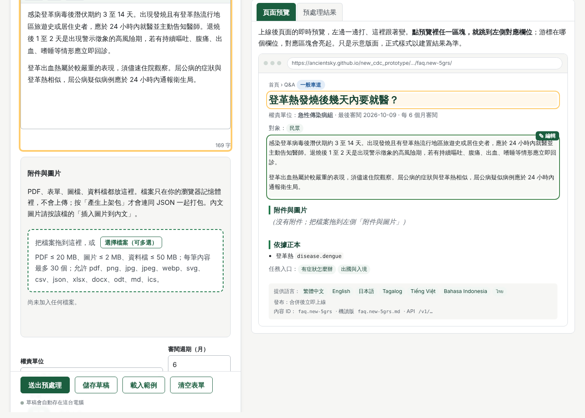
  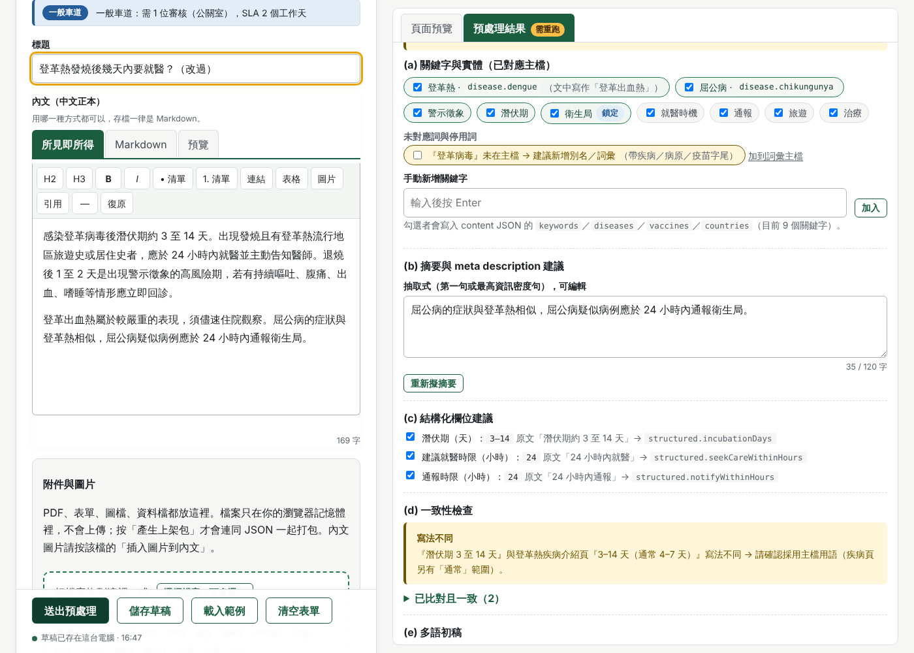

> 限制：預覽是「示意版面」，用後台的樣式畫出同樣的資訊結構，不是跑真正的頁面模板（那要把 Node 端模板搬到瀏覽器）；正式長相以 PR 預覽網址為準。沒有做 TinaCMS 的「在真實頁面上直接打字」，因為本原型的正本是 JSON 欄位加 Markdown，表單才是改欄位的地方。
## 第二十一輪：長文件分章摺疊閱讀版面

起因：Yulun 回饋轉好的《登革熱/屈公病防治工作指引》文件頁「超級長，也不好看」。原本 45 段一路攤開（約 59,000 像素），目錄是 45 行重複章名的長標題，手機上是 45 顆按鈕。這輪

- **分章摺疊**（`src/templates/public/_longdoc.mjs`）：頂端章節卡（每章頁碼範圍、節數）；每章大標題下，每節是預設收合的一列（短標題＋頁碼）；章導言與前言攤開；一章分兩病時加「登革熱／屈公病」小標；表單、地圖附件標「表單・看 PDF」。頁面高度降到約 6,600 像素。
- **好讀**：「壹、一、（一）1.（1）」依層級縮排、短標題加粗；「第 N 頁」縮成右側小標籤；行長限制在約 42 字。
- **目錄**：桌機右側「章／節」兩層、限高、黏在畫面上並標示目前這一節；手機改用頂端章節卡。
- **引用不斷**：段落 `#s-{key}`、頁碼 `#page-N` 錨點都沒變；從智慧查詢引用連過來會自動打開那一節。全部展開／收合、列印前自動展開。
- 只套用在 PDF 轉來（有頁碼範圍）或 12 段以上的文件，其他文件版面不變。設計理由見 [docs/pdf-ingest.md](docs/pdf-ingest.md) 第 8 節；契約 ARCHITECTURE §24。

  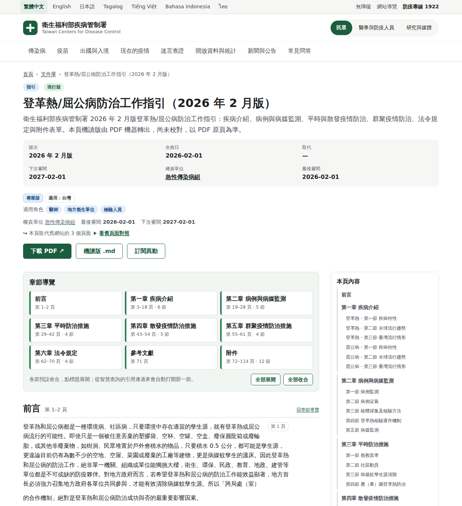 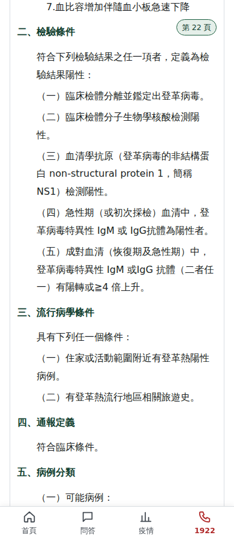

## 第二十輪：真的登革熱/屈公病指引取代虛構版本鏈；圖片與影片怎麼讓智慧查詢找得到

起因：Yulun 決定以真的 2026 年 2 月版指引取代原型虛構的「第 15～17 版」，並問圖片與影片（通常先上 YouTube 再貼連結）要怎麼做智慧查詢才找得到。這輪

- **取代虛構版本鏈**：真指引改用原家族 id（`doc.guidance-dengue.2026-02`，family `doc.guidance-dengue`），所以疾病頁、Q&A、影音、社區指引寫的家族參照自動指到它；刪除虛構第 15～17 版與宣布第 16、17 版的兩則通函；社區防治指引的群聚定義改引真指引（150 公尺、14／12 天），Q&A 刪掉虛構的「14 日內每週追蹤」；影音依據版本標示、移轉清單目標、評估集版本題（V010、V011、PR009）改成真指引。評估集 203 題全過、版本題 19/19。
- **歷史批次保持可重現**：被移除的檔案與當時的移轉清單放 `data/legacy-export/_retired/`，模擬匯出與批次測試讀「現行內容＋_retired」組回 2026-10-03 的樣子，已提交的匯入紀錄不必重跑。理由見 [docs/legacy-import.md](docs/legacy-import.md) 10.12。
- **圖片與影片**：手冊新增第 23 節——智慧查詢只讀文字：影片要在官網建影音內容並填逐字稿（帶時間標記，答案會連到那一秒），可用 YouTube 自動字幕整理後校對；承載資訊的圖（海報、懶人包、圖表）要有人確認過的純文字版，放在內文或出版品摘要，alt 只寫重點，圖表數字另給資料檔。

> 限制：真指引仍是機器轉出、未校對（不進 AI 白名單），PDF 原檔、生效日與紅字異動待補；評估集的登革熱版本題因此只驗證「引用現行版」，不驗證異動內容。

## 第十九輪：PDF 指引讓智慧查詢查得到、引用到頁碼；AI推動辦公室＝OASIS；手冊補寫

起因：Yulun 確認「AI推動辦公室」與原型的「OASIS」是同一單位，並提供 2026 年 2 月版《登革熱/屈公病防治工作指引》（114 頁，紅字掛網版的抽出文字）問：PDF 除了上傳下載，要怎麼處理才能讓智慧查詢查到並引用？另請把建議寫進手冊，並檢查之前做完但手冊沒寫的部分。這輪

- **PDF → 機讀版**：`scripts/pdf-to-md.mjs`（PDF 或抽好的文字 → 文件 JSON）＋ `scripts/lib/pdf-text.mjs`（純函式）。依章／節／附件切段，每頁插頁碼標記 `〔p.N〕`，換行與跨頁斷句接回；表格頁與頁中數字表格換成「請看 PDF 第 N 頁」說明，表單、地圖附件與參考文獻標 `index: false`。轉換來源記在 `derivedFrom`（檔名、sha256、工具、日期、校對狀態、表格頁）。
- **引用帶頁碼**：索引對有頁碼標記的段落**每頁一塊**，網址連到文件頁 `#page-N`；專業版引用標籤加「（第 N 頁）」，來源卡多「頁碼」一列與「開啟 PDF」（知道封面目錄頁數 `pdfPageOffset` 時直接跳頁）。順帶修正文件段落網址錨點（原本 `#key`，頁面 id 是 `#s-key`）。
- **沒校對的不當真**：`derivedFrom.reviewStatus: machine` 的文件不進 AI 白名單、排序在已審內容之後、來源卡標黃色「尚未人工校對，以 PDF 為準」，並開連動待辦「PDF 機讀版待校對」（列出要轉的表格頁、紅字要填 `changes`）。
- **實際匯入**：`doc.dengue-chik-guideline.2026-02`（45 段、34 段入索引；表格 13 頁＋頁中數字表格 2 頁；表單 9、地圖 1 不入索引）。評估集新增 4 題 PDF 題（203 題全過，版本題 19/19）。
- **AI推動辦公室**：主檔 `unit.oasis` 改名「AI推動辦公室」／「Office of AI Strategy, Innovation, and Synergy (OASIS)」，刪除第十八輪暫加的 `unit.ai-office`；id 不變，所有內容與規則照舊。
- **手冊**：[docs/pdf-ingest.md](docs/pdf-ingest.md)（給承辦與資訊室：為什麼不能直接丟 PDF、五步流程、校對清單、正式環境要補什麼）；[docs/guide-staff.md](docs/guide-staff.md) 新增第 20 節（PDF SOP）、第 21 節（後台各頁用途、複核區用法、連動待辦對照表——補上先前只列名稱沒寫怎麼處理的譯文過期、資料集、失效版連結、態勢逾期等）、第 22 節（首頁 Banner 上下架）；更正 2.1 的複核四步為實作的「承辦人確認 → 公關室 → 多語 → 發布」。契約 ARCHITECTURE.md §22。

> 限制：(1) 這次只收到抽好的文字檔，沒有 PDF 原檔，所以紅字修訂處抽不出來、PDF 下載連結先放待補頁、頁碼偏移未填；(2) 原型另有一條**虛構**的示意版本鏈「登革熱／屈公病防治工作指引（第 15～17 版）」，和真的 2026 年 2 月版同名、內容不同（例如群聚定義），本輪兩者並存，是否以真文件取代待決定；(3) 生效日、權責單位為暫填，待急性傳染病組確認。

## 第十八輪：後台登入怎麼設計、權責單位點得進去

起因：同事問「假如要設計後台維護登入，要怎麼設計比較好？」以及「每頁的權責組室能不能點一下連回他們的介紹網頁？」這輪

- **後台登入**：建議**接機關 SSO（OIDC）＋雙因子，不另設帳號密碼**；單位與角色由 AD 群組帶入（`CDC-WEB-<unit>-<role>`），每個動作綁個人並留稽核。三種做法（自建帳密／機關 SSO／Git 平台帳號）的比較與為什麼選 SSO，見 [docs/admin-auth.md](docs/admin-auth.md)。原型新增 `/admin/login/`：沒登入進任何後台頁都會被導過去，選一個示範帳號（姓名遮罩）等於模擬 IdP 回傳身分；登入後右上顯示姓名、單位、角色與登出鈕。
- **角色×單位，規則只有一份**：承辦人、複核者、疫情發布、內容總編輯、治理幕僚、平台管理六種角色；複核區、疫情發布、AI 開關、評估四頁限角色，其他頁任何同事可進但只看自己單位；只有總編輯、OASIS、資訊室能切換單位視角。進不去會看到「不在你的角色權限內」並寫稽核。規則在 `src/client/admin/auth-rules.js`（純函式，瀏覽器與測試共用），登入頁的對照表、前端閘門、測試都讀同一份。
- **權責單位可點**：全站每個「權責單位」改成連結，連到新的單位介紹頁 `/about/units/{slug}/`（24 個單位、中英文、`.md` 機讀版）：簡介、主要業務、該單位在本站維護的全部內容（建置時由 `owner` 自動算）、聯絡。簡介為原型撰寫、標「尚待該單位確認」；主要業務改用處務規程的掌理事項；右側連到現行官網的「組織與職掌」與單位介紹頁（現行官網所有單位同一頁，沒有各單位獨立網址）。順帶把主檔的「整備應變組」更正為官網名稱「新興傳染病整備組」，並補上「AI 推動辦公室」（第十九輪確認它就是 OASIS，見下）。契約 ARCHITECTURE.md §21。

> 限制：原型沒有後端，登入與稽核只存在瀏覽器；正式環境由閘道回 302／403、集中式稽核。

## 第十七輪：開發者入口不再先看到「國際合作」、首頁「更多服務」去重、頁尾改成分組的 fat footer

起因：同事截圖指出三件事——開發者入口一打開是「國際合作」的進入按鈕（第六輪放的導引卡，但放在 API 說明頁首很突兀）；首頁底部有「更多服務」區塊，和頁尾的服務清單是同一組連結，看起來像重覆；以及「現在還流行 fat footer 嗎」。這輪

- **開發者入口**拿掉「國際合作」導引卡。該卡原意是給外國 API 使用者找英文入口，但放在頁首會讓人以為走錯頁；國際合作已在主選單與頁尾「關於與政策」欄，不必再在這裡擋路。
- **首頁「更多服務」區塊移除**。原本首頁最底部一塊「更多服務」卡片列 + 頁尾又一排同名連結，兩處同一組內容。改成只留頁尾一份，首頁回到「疫情 → 問答 → 熱門主題 → 新聞」的主線，少捲一屏。
- **頁尾改成四欄分組的 fat footer**：服務（出版品、申請、檢驗、通報、招募、採購、宣導…）、關於與政策（關於疾管署、國際合作、隱私、AI 聲明、無障礙、使用說明、網站導覽）、開放資料與開發者（開放資料、API、授權、AI 透明報告、後台示範）、聯絡（1922／0800-001922 防疫專線大字、署長信箱、通報專區）。平板兩欄、手機一欄堆疊。
- **為什麼 fat footer 還是對的**：政府與機構網站（gov.uk、數位發展部、各部會）至今都用分組式頁尾——它是使用者捲到底時的「第二導覽」，也是搜尋引擎與輔助科技讀站點結構的地方。過時的不是 fat footer 本身，而是「把所有連結丟成一長排」的做法；分組、每欄有標題（`<nav aria-labelledby>`）、聯絡資訊獨立一欄，才是現在的做法。首頁不再另做「更多服務」區，正是因為頁尾已經承擔這個角色。
- 多語：四個欄標題與專線說明補齊七語（`footer.group.*`、`footer.hotline.note`）。契約 ARCHITECTURE.md §20。

## 第十六輪：人才招募與採購公告終於能在後台上架、改期、取消、公布結果

起因：人才招募（job）與採購公告（tender）第七輪分成獨立型別後，`/admin/publish/` 不提供它們，`/admin/jobs/`、`/admin/tenders/` 只是唯讀總覽，承辦人要上架得手寫 JSON。這輪

- **兩個上架與異動表單** `/admin/jobs/edit/`（人事室）與 `/admin/tenders/edit/`（秘書室），照「疫情發布」的模式：表單 → 即時預覽與檢核 → 匯出 JSON → 開 PR（快車道，CI 過自動合併）。選既有職缺／標案就帶入全部欄位，四個區塊：公告內容、時程異動（延長截止、改甄試日／開標日）、取消（停止甄選、流標、廢標）、結果公告（錄取名單：正取、備取、遞補；決標：得標廠商、金額）。
- **公告異動紀錄 `amendments[]`**（兩個 schema 都加）：改日期不是改完就算，表單會追加一筆「哪天、改了什麼、一句話說明、字號」，前台詳情頁有「公告異動」區、列表卡標「有異動」，`.md` 機讀版同步。民眾與廠商看得到歷程，承辦人不必另發更正新聞稿。
- **規則只寫一份**：甄選結果個資檢核（遮罩姓名、報名編號）與階段推導從建置腳本抽到 `src/client/careers-rules.js`，後台表單在瀏覽器即時用同一份函式檢核，CI 建置也用它；表單說「可上架」就一定過得了 CI。
- 首頁疫情卡示範資料四筆統一回「標準」樣版（樣版功能保留，疫情中心要換再在表單選）。
- 文件：docs/guide-staff.md §16.10、§17.6（表單操作與「原本 → 改成 → 為什麼」）；契約 ARCHITECTURE.md §19。

## 第十五輪：「疫情發布」改名、首頁疫情卡四種樣版

- 後台「態勢發布」全站改稱**「疫情發布」**（選單、頁名、SOP、RSS 說明）；檔案與網址不變。
- 首頁「現在的疫情」卡可選**四種樣版**：標準、趨勢圖（近週趨勢線）、行動優先（建議放最大）、精簡（一行指標）。樣版是 `situation/current.json` 每筆的 `cardStyle` 欄位，疫情中心在疫情發布表單勾選、即時預覽、可並排比較，隨發布 PR 一起進版，不必改程式。契約見 ARCHITECTURE.md §2.2，操作見 docs/guide-staff.md §4。

## 第十四輪：疫苗接種時程地圖、「幾歲能打哪些公費疫苗」

起因：問答對「65 歲以上可以打哪些公費疫苗」只答到一種疫苗，因為沒有一份按年齡排好全部疫苗的資料。這輪

- **疫苗接種時程表主檔** `content/master/immunization-schedule.json`（42 筆「劑次 × 對象」，年齡一律用月、公費／條件公費／自費三分、每筆有來源與 `verified`），API `v1/immunization-schedule.json`；疫苗主檔補四合一、輪狀、Tdap、帶狀疱疹。首版全部標「待承辦人確認」。
- **互動時程地圖** `/vaccines/schedule/`：一列一疫苗、橫軸年齡分段刻度，輸入年齡高亮「現在可打／即將／已過建議年齡」，點標記看劑次、對象、來源、疫苗頁與接種點；分段頁籤；無 JS 仍有同資料表格與 `.md` 機讀版。
- **問答跨疫苗彙整**：問句有年齡或身分、沒指定單一疫苗時，由時程表篩出符合月齡的項目，一疫苗一句、每句引用該疫苗頁；行動鈕「看完整疫苗時程地圖」帶 `#age=`。評估集 VA011–VA014。
- **順帶核對出的錯誤**：肺炎鏈球菌成人公費 2026-01-15 起已改為 1 劑 PCV20／PCV21，疫苗頁與 Q&A 原本仍寫兩劑，已改；HPV 國一男生補納入年度。
- 契約見 ARCHITECTURE.md §18；承辦人維護方式見 docs/guide-staff.md §18。

## 快速開始

需求：Node.js 22 以上（repo 根目錄有 `.nvmrc`／`.node-version`；第四十八輪 #105：測試用到的 pdfjs-dist 需要 Node 22 的 `Promise.withResolvers`，Node 20 會有一項測試失敗）。

```bash
npm ci            # 安裝依賴（只有 ajv、ajv-formats、marked）
npm run build     # 建置到 dist/
npm run dev       # 建置並啟動預覽 http://localhost:4173/new_cdc_prototype/
```

其他：`npm test`（治理規則測試）、`npm run check`（只驗證不輸出）、`npm run eval`（跑評估集）、`npm run fetch`（抓官方資料快照）。想用根路徑預覽：`BASE_PATH='' npm run build && node scripts/serve.mjs`。

詳見 [docs/deploy.md](docs/deploy.md)。

## 三種使用者入口

| 你是 | 從這裡開始 | 說明文件 |
| --- | --- | --- |
| 民眾 | [首頁](https://ancientsky.github.io/new_cdc_prototype/)：一句話提問、現在的疫情、六個任務、謠言查證 | [docs/guide-public.md](docs/guide-public.md) |
| 醫師、護理、感染管制、檢驗、地方衛生單位 | [專業人員專區](https://ancientsky.github.io/new_cdc_prototype/pro/)（或網址加 `?view=pro`）：版本異動對照、訂閱、專業問答、常用作業 | [docs/guide-professional.md](docs/guide-professional.md) |
| 同事（Steward、公關室、資訊室、OASIS、疫情中心） | [後台](https://ancientsky.github.io/new_cdc_prototype/admin/)：上架預處理、待辦、審閱到期、疫情發布、AI 開關、評估 | [docs/guide-staff.md](docs/guide-staff.md) |

另有給開發者與研究者的 [開發者入口](https://ancientsky.github.io/new_cdc_prototype/developers/)（API、OpenAPI、`llms.txt`、JSON-LD、`cdc:` 詞彙）、[AI 透明報告](https://ancientsky.github.io/new_cdc_prototype/transparency/)與[使用指南](https://ancientsky.github.io/new_cdc_prototype/guide/)。

## 治理自動化清單

以下全部由建置時的治理引擎（`scripts/lib/governance.mjs`）自動完成，不需要人記得去做：

- 下次審閱日計算；逾期 → 頁首黃色警示、退出 AI 白名單、開待辦
- 文件新版發布 → 舊版自動標失效（紅色警示、`noindex`、退出索引、301 對照）
- 依據的正本被修訂 → 衍生新聞稿與 Q&A 自動加註、退出白名單、給 owner 7 日待辦
- 反向稽核：宣告過的失效說法（如 MMR「1981 年」）掃全站命中即開待辦
- 譯文 `sourceHash` 對不上 → 標示「中文已更新，譯文待複核」；一級內容未審核不渲染該語言頁
- 資料集更新逾期與授權不合規 → 待辦
- 公告過了截止日 → 自動標「已截止」並退出首頁，不需人工
- 影片製作日早於依據正本現行版生效日 → 自動標過時、退出白名單、開待辦；逐字稿不足 50 字 → 待辦
- 外部連結每日檢查，失效 → 待辦；檢驗送驗時限與主檔通報時限不一致 → 待辦
- 舊站移轉清單中狀態為「待確認」（`pending`）的項目 → 自動開 `migration-pending` 待辦給權責單位；新頁的「舊網址對應」揭露在 `showLegacyUntil` 過後自動隱藏，不需人工；舊網址轉址對照（301）與伺服器格式每次建置自動重算
- 招募階段（即將開放、報名中、已截止、審查與甄試中、結果公布）與採購階段（招標中、已截止、已開標、已決標）由日期與結果推導，截止自動退場、結果滿 90 天自動進歷史、備取有效期過後自動不顯示；結果逾期、備取將到期、外部報名網址失效、決標逾期 → 待辦
- 甄選結果個資遮罩：`nameMasked` 未遮罩、報名編號像身分證字號、正取數超過名額 → 建置失敗；AI 白名單排除名單，答案引擎不唸錄取者
- 採購公告開標後 30 日仍無決標資訊 → 待辦；本站只做入口與狀態，正式公告以政府電子採購網為準
- 檔案資產宣告與建置檢查（規則 22）：宣告的檔案不存在、`sha256`／`bytes` 不符、超過大小、格式或檔名不合法、SVG 含腳本、內文引用了未宣告的 `/files/` → 建置失敗；`content/assets/{id}/` 有檔卻未宣告 → 孤兒檔警告與 `asset-orphan` 待辦
- 圖片 alt 與授權是建置閘門（規則 23）：圖片缺 alt 或 license → 建置失敗；非本署素材缺來源 → `image-license-missing` 待辦
- PDF 沒有文字層又沒附可及性替代版（規則 24）→ 待辦 `attachment-no-accessible-version`
- 發布車道（規則 25）：內容依型別由系統判定車道（快車道、一般車道、緊急發布），CI 檢查全過才可能合併；快車道與緊急發布自動合併、一般車道需 1 位核准；一個 PR 含多種內容取最嚴格；`urgent` 用在不允許的型別 → schema 驗證失敗
- 排程發布（規則 26）：`publishAt` 未到點 → 不渲染、不進索引／sitemap／API／RSS／`llms.txt`，狀態「排程中」；到點後下一次建置（每 2 小時）自動上線
- 上線後複核（規則 26）：快車道與緊急發布的內容上線後，自動開 `post-publish-review` 待辦給公關室，期限上線後 24 小時，逾期升為高優先；PR 逾 SLA 由 CI 加 `sla:breach` 標籤並留言
- 舊站匯出轉換草稿（規則 27）：信心 < 0.6 → 建議人工檢視；草稿一律 `status: review`、不直接進 `content/`；`--apply-migration` 不動 `verified`
- AI 暫停開關 → 全站橫幅，答案頁退回傳統列表
- KPI 與季度 AI 透明報告每次建置重算
- 評估集閘門：版本題只要錯一題，建置失敗
- 旅遊疫情等級表把官方「歷次警示事件」當事件日誌處理：每國每病最新一則、解除即不列；同一疾病同一等級涵蓋 ≥ 50% 國家自動歸為「全球背景提醒」不逐國列；近 30 天新增／調升／調降／解除自動統計；live 分布病態時自動退回人工校對快照並記錄原因

## 目錄

```
ARCHITECTURE.md      架構與約定（人與 AI 協作者的共同契約，動手前先讀）
site.config.mjs      站台設定：basePath、語言、網址
schemas/             JSON Schema，content/ 每種型別一份
content/             ★ 內容與資料的單一事實來源（人維護）
data/snapshots/      每日抓回的官方資料快照
scripts/             build.mjs、serve.mjs、fetch-data.mjs、lib/（治理、API、SEO、渲染）
src/templates/       public／pro／admin 頁面模板（自動登錄）
src/client/          瀏覽器端：答案引擎、後台、專業專區互動
eval/                評估集執行（與瀏覽器共用答案引擎核心）
tests/               node:test 治理規則測試
docs/                使用說明與治理文件
.github/workflows/   GitHub Pages 建置與部署（含每日排程）
```

完整說明見 [ARCHITECTURE.md](ARCHITECTURE.md)。

- **相關專案**：[疫苗及流感藥劑地圖 vaxmap-next](https://ancientsky.github.io/vaxmap-next/)（接種點、庫存、八語）。本站所有接種點入口以深連結導向它，整合方案見 [`docs/vaxmap-integration.md`](docs/vaxmap-integration.md)。

## 資料來源與示意聲明

- **官方來源資料**：旅遊疫情、國家等級與事件流、CKAN 資料目錄由 `scripts/fetch-data.mjs` 抓取到 `data/snapshots/`，每檔記錄來源與時間；CI 排程每日抓取後把快照 commit 回 `main`，所以 repo 內的快照就是當日官方資料（`meta.mode: 'live'`）；抓不到時沿用既有快照並在 `meta.lastLiveAttempt` 記錄原因。
- **示意資料**：疫情態勢的狀態與數字（頁面標「示意」）、致醫界通函卡片、專區的「○○醫院」登入畫面、白名單核准日期、評估集題目與通過率。**不可當作真實疫情或機關決議引用。**
- **內容文字**：範例中的疾病、疫苗與 MMR 建議內容依公開資訊撰寫，用於示範版本鏈與連動；正式上線前須由權責單位逐字審閱。
- 本原型不放真人姓名與個資，承辦人以職稱表示。
- 本專案為概念驗證，與衛生福利部疾病管制署的現行官方網站無隸屬關係，內容不代表官方立場。

## 授權

網站內容與 API 資料預設採**政府資料開放授權條款第 1 版（OGDL-1.0）**，個別資料集另有標示（CC0-1.0、CC BY 4.0）。引用請附頁面網址與最後審閱日，格式見[開發者入口](https://ancientsky.github.io/new_cdc_prototype/developers/#license)。

## 文件

| 文件 | 內容 |
| --- | --- |
| [docs/guide-public.md](docs/guide-public.md) | 民眾使用說明（含七語與無障礙） |
| [docs/guide-professional.md](docs/guide-professional.md) | 公衛醫療人員使用說明（引用、訂閱、核對版本） |
| [docs/guide-staff.md](docs/guide-staff.md) | 同事操作手冊與各項 SOP |
| [docs/governance-model.md](docs/governance-model.md) | 資料治理模型：欄位、規則、KPI、白名單、授權、個資 |
| [docs/architecture-decisions.md](docs/architecture-decisions.md) | 為什麼這樣做；示意與真實的區分 |
| [docs/deploy.md](docs/deploy.md) | 部署與維運、新增內容型別、改 schema |
| [docs/roadmap-mapping.md](docs/roadmap-mapping.md) | 原型功能與三階段路線圖對照 |
| [docs/migration-playbook.md](docs/migration-playbook.md) | 舊站→新站內容移轉與網址轉址手冊：301／410 策略、搜尋引擎、舊站保留期、切換日 checklist、404 log 監測、常見錯誤、結核病示範 |
| [docs/plan-supplement.md](docs/plan-supplement.md) | 規劃文件回補：原型做了、規劃沒寫到的 39 項作法（做法、為何需要、對應規劃章節、原型位置、正式上線還缺什麼） |
| [docs/assets-policy.md](docs/assets-policy.md) | 檔案資產政策：附件、圖片、資料檔放哪裡（`content/assets/{id}/` → `/files/{id}/`）、命名與正規化、格式與大小、PDF 可及性（文字層、標籤、`.md` 替代版、掃描檔）、圖片 alt／來源／授權、資料檔與 CKAN、版本與保存、刪除與下架、病毒掃描與個資、與 `/pending/` 的關係、同事檢查清單 |
| [docs/publishing-lanes.md](docs/publishing-lanes.md) | **發布車道建議書**：舊後台直接上架 vs 新流程的問題、設計原則（流程看不見、CI 當審核者、分車道、多語不擋中文）、車道表（型別、自動合併、審核人、SLA、上線後複核）、送出到上線 3 分鐘的拆解、PR 預覽網址、預定與緊急發布、上線後複核、CODEOWNERS 與權限、SLA 逾期處理、試行計畫（兩單位、兩個月）、按鍵數對照表、風險與對策、GitHub 工作流程說明與驗證結果 |
| [docs/legacy-import.md](docs/legacy-import.md) | 舊站匯出批次轉換：匯出格式規格（側檔欄位）、規則檔怎麼寫、信心分級與人工檢視原則、三級處理（現行一級內容人工確認／近年新聞自動上線／久遠封存）、PDF 不整批轉、報告怎麼看、結核病首批、登革熱第二批、流感第三批、麻疹＋腸病毒第四批、其他第一、二類傳染病第五批、新聞與公告第六批、指引與手冊第七批、常見問答第八批、國際旅遊與健康第九批、宣導素材第十批、統計資料第十一批結果（每批新增的處理經驗與理由；第四批起出版品、影音、資料集、檢驗、服務、澄清稿直接產成結構化型別，第五批起相關連結→專區、疫苗專區→疫苗頁，沒有人工清單的疾病用合成清單轉；第六批新聞欄目無清單、三級處理＋ 10% 抽樣名單、通函建 letter；第七批文件版次鏈；第八批 Q&A 跨批重複判定、鬆散結構拆題、tasks 與 structured 候選、期限已過警告；第九批資料產生頁不轉內文、清單 `newPath` 路徑去處、查詢表單頁、主檔沒有的疫苗）、正式批次排程建議 |
| [docs/a11y.md](docs/a11y.md) | **無障礙基準與自我評量**：新版網站無障礙規範 AA（WCAG 2.2 AA）、2.2 新增準則、現況表（含待人工稽核）、axe 發現與修法、怎麼跑 `npm run a11y` |
| [docs/git-as-cms.md](docs/git-as-cms.md) | **給資訊室與主管**：新官網為什麼用 Git＋CI 而不是傳統後台上架系統——兩種機制的比較表（正本、誰按上線、審核、自動檢查、預覽、追溯、回復、權限、排程、資安、備份、廠商綁定、要學什麼）、資訊室要維運的清單、代承辦人送出服務、風險與對策 |
| [docs/admin-auth.md](docs/admin-auth.md) | **後台維護登入怎麼設計**：自建帳密 vs 機關 SSO＋MFA vs Git 平台帳號的比較與建議、正式登入流程、角色×單位對照（程式只有一份）、原型做了與沒做什麼、資訊室實作清單、權責單位可點為何順便做 |
| [docs/immunization-ia.md](docs/immunization-ia.md) | **預防接種專區怎麼放**：官網「預防接種」分類子項對應到新站型別的對照表、入口設計、承辦人待辦、本輪學到的事（第三十六輪） |
| [docs/bulletin.md](docs/bulletin.md) | **《疫情報導》重新設計**：向 MMWR 借了什麼、文章為單位的資料模型、卷期目錄怎麼自動組、上架後台流程、示範內容來源與正式上線前要補的事；第三十五輪補作者上標與通訊作者、DOI 與轉址、分類主檔與分類頁、拖圖上架、PDF 貼文切段；第四十五輪補上傳 PDF 自動帶入欄位、全文與圖，送審件帶附件與卷期走閘道上線；第四十六輪補九份真實 PDF 的實測、表格依座標還原、已知限制 |
| [docs/line-chatbot.md](docs/line-chatbot.md) | **LINE「疾管家」能不能用新網站當知識庫**：網站現有的知識出口（`.md`、`/v1/*.json`、`llms.txt`、答案索引）、三種接法（只換連結／呼叫同一份問答引擎／再加語言模型）比較與建議順序、要問承辦與廠商的問題、風險與對策（第三十八輪） |
| [docs/i18n.md](docs/i18n.md) | **多語工程筆記**：詞彙退回規則（`id_` 欄位、永不顯示 `term.*` 鍵值）、外語頁中文比例檢查（`I18N_CJK_CHECK`）、「這頁沒有你的語言」提示、機器翻譯初稿怎麼審核後上線、來臺專區（第四十輪） |
| [docs/ask-log.md](docs/ask-log.md) | **智慧問答查詢紀錄**：記什麼、不記什麼（遮兩次、無 IP、時間到分鐘、不要追蹤就不送）、為什麼用 fetch keepalive 不用 sendBeacon、k-匿名報表與疑似同義詞候選、正式收件端契約與資訊室確認清單、離線 LLM 掛點（第四十一輪） |
| [docs/intl-epidemic.md](docs/intl-epidemic.md) | **國際重要疫情資訊自動上架**：四種做法比較（表單／拉取／推送／標準 feed）、交換格式 v1（JSON、CSV、舊官網匯出）、三條路一個匯入器、機器把關規則、實作位置、要請疫情中心與資訊室回答的問題、本輪教訓（第四十三輪） |
| [docs/transition-faq.md](docs/transition-faq.md) | **同事常問的五個問題**：小改現行官網能不能導入 AI 與治理（能外掛問答、不能做治理）、新站另做舊站留著會怎樣（只能唯讀並行）、怎麼驗廠商能力（三道實作題）、200 字差別說明、費用與時程估算與切換做法、LINE 疾管家會不會跟著換（連到 line-chatbot.md） |
| [docs/careers-privacy.md](docs/careers-privacy.md) | 人才招募個資處理原則：報名資料不進 repo、模擬報名只存瀏覽器、正式報名在站外或後端、只公布報名編號與遮罩姓名、保存與下架、查詢與刪除、個資法對應與告知事項範本 |

## 貢獻方式

內容改動走 Pull Request：改 `content/` → CI 驗證（schema、治理規則、評估集）→ 複核者核准 → 合併即發布。程式改動請先讀 ARCHITECTURE.md 第 7、10 節的約定（連結一律用 `ctx.url()`、插值一律跳脫、治理邏輯只放在引擎）。
