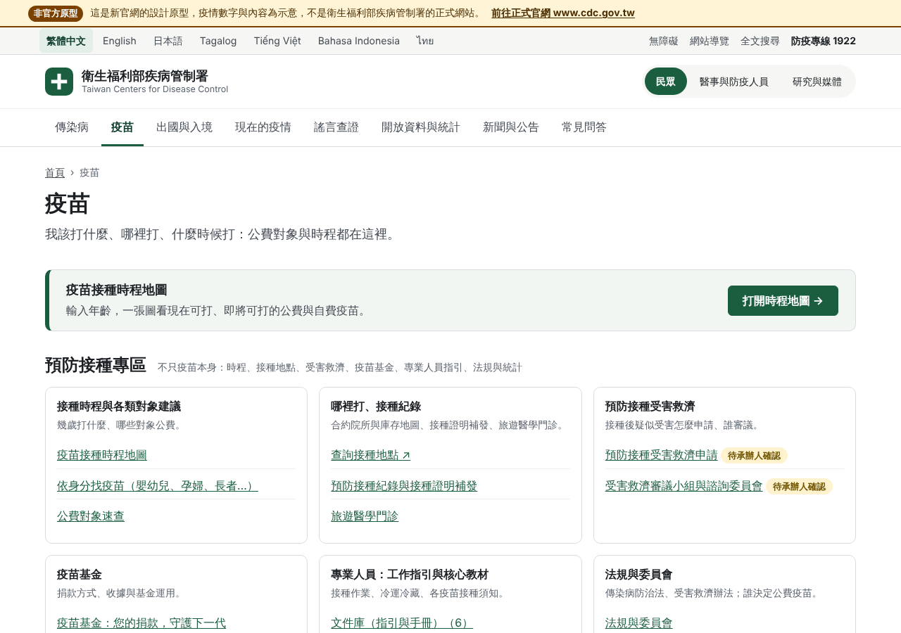

# 預防接種專區：官網分類怎麼對應到新站（第三十六輪）

給急性傳染病組（預防接種）、公關室、OASIS 與資訊室看。回答同事的問題：「疫苗（預防接種）的資料不只疫苗本身，還有受害救濟、接種工作指引、疫苗基金……這些要放哪裡？」

官網分類頁：<https://www.cdc.gov.tw/Category/List/jEcJbcX-J8_opidAmw3dyg>（開發環境連不到 cdc.gov.tw，以下子項是從搜尋結果整理的，**名稱與層級請承辦人對照官網左側選單核對**）。

## 1. 原則：依「讀者要做的事」放，不依「單位怎麼分」放

舊站把預防接種分類當成一棵樹，民眾、醫護、研究者都從同一個入口往下找。新站的做法：

1. **一個事實只放一份。** 疫苗的公費對象在疫苗頁（正本），時程在時程主檔；受害救濟是「申請／服務」型別；工作指引是「文件」型別；法規連到全國法規資料庫。沒有「預防接種專區自己再抄一份」。
2. **入口可以多個，內容只有一個。** `/vaccines/` 頁多了「預防接種專區」導覽卡，把散在各型別的內容按讀者的事情分成七格；專業人員專區、文件庫、申請服務頁各自也列得到同一筆。
3. **每一筆內容有 Owner 與審閱日**，所以放進任何型別都受同一套治理（逾期待辦、AI 白名單、待確認標示）。這是舊站做不到的：分類頁裡的附件過期了沒人知道。

## 2. 對照表

| 官網「預防接種」子項（待核對） | 新站位置 | 型別／檔案 | 狀態 |
| --- | --- | --- | --- |
| 疫苗資訊 › 公費疫苗項目與接種時程（現行兒童時程表 11401 版、成人 19–64／65+ 建議時程） | [/vaccines/schedule/](../src/templates/public/vaccine-schedule.mjs) 時程地圖＋表格＋CSV／JSON | 主檔 `content/master/immunization-schedule.json` | ✅ 已有（42 筆待核對） |
| 疫苗資訊 › 各類對象預防接種建議（嬰幼兒、孕婦、長者、醫護、高風險） | 時程地圖的階段頁籤＋ `/tasks/vaccines/`（依身分找） | 同上 | ✅ 已有；醫療照護工作人員建議尚無獨立內容 |
| 疫苗資訊 › 疫苗簡介（各疫苗） | `/vaccines/{slug}/` 疫苗頁 | `content/vaccines/*.json` | ✅ 已有 11 頁；黃熱病、流腦、傷寒等旅遊疫苗沒有主檔項目（第九批已記） |
| 預防接種單位及諮詢資訊（合約院所、狂犬病疫苗施打點、日本腦炎自費院所） | 疫苗頁「哪裡打」→ vaxmap 深連結；`/travel/` 旅遊醫學門診 | `docs/vaxmap-integration.md` | ✅ 流感／新冠／肺鏈有地圖；其他疫苗連到接種資訊頁。狂犬病施打點清單待資料來源 |
| 預防接種資料查詢（接種紀錄、入學查核） | [/apply/vaccination-record-reissue/](../content/services/vaccination-record-reissue.json) | `service` | ✅ 已有；健康存摺／NIIS 連結待確認 |
| **預防接種受害救濟**（簡介及申請說明、表單下載、審議結果） | [/apply/vaccine-injury-compensation/](../content/services/vaccine-injury-compensation.json) | `service`，`verification: pending` | 🆕 本輪新增骨架（流程、期限、應備文件、FAQ 待逐項核對） |
| **主動捐款疫苗基金** | [/topics/vaccine-fund-donation/](../content/topics/vaccine-fund-donation.json)＋[/apply/vaccine-fund-donation/](../content/services/vaccine-fund-donation.json) | `topic`＋`service` | ✅ 已有 |
| **衛生專業人員工作指引**（接種計畫、接種指引、接種實務、冷運冷藏）與核心教材 | `/documents/`（文件庫，`docType: guideline／manual／curriculum`，`vaccines[]` 標疫苗）＋ `/pro/` 專業人員專區 | `content/documents/*.json` | ⚠ 文件庫已有流感疫苗接種計畫與作業手冊；其他指引要用第十九輪的 PDF 匯入工具逐份上架（`docs/pdf-ingest.md`） |
| **相關法規與委員會**（ACIP、受害救濟審議小組、法規） | [/vaccines/committees/](../content/pages/immunization-committees.json)（誰決定什麼）＋ `/policy/legal/`（條文連全國法規資料庫） | `page`，`verification: pending` | 🆕 本輪新增骨架；委員會全銜與會議紀錄網址待確認 |
| 預防接種統計（接種率、各年統計） | `/data/` 資料目錄＋ `v1/immunization-schedule.json`／`.csv` | `content/datasets/*.json` | ⚠ 時程表資料已開放；接種率資料集尚未登錄，請統計承辦提供 CKAN 或檔案來源 |
| 疫苗採購、疫苗冷運冷藏（物流） | `/procurement/`（採購公告）；冷鏈指引歸文件庫 | 既有型別 | ⚠ 冷運冷藏指引待上架 |

圖例：✅ 已有、🆕 本輪新增（內容標「待承辦人確認」）、⚠ 入口有了、內容待補。

## 3. 入口長什麼樣

`/vaccines/` 頁在時程地圖入口卡下方，多一區「預防接種專區」七格：接種時程與各類對象建議、哪裡打／接種紀錄、預防接種受害救濟、疫苗基金、專業人員工作指引與核心教材、法規與委員會、接種統計與開放資料。每格 2–3 個連結，只連站內已存在的頁（建置時的站內連結檢查會擋掉不存在的）；`verification: pending` 的頁旁邊帶「待承辦人確認」。

為什麼不做成左側樹狀選單：舊站的樹要讀者先知道「受害救濟在預防接種底下的第五層」；新站的七格是讀者的七件事，三步內到達，手機上也是七張卡不是七層。

## 4. 承辦人接下來要做的事

1. 對照官網左側選單，把第 2 節第一欄的子項名稱與層級改正（本文件直接改）。
2. 受害救濟頁：逐項核對 `verification.pendingItems`（申請期限、天數、金額是否列出、正式表單網址），核對完把 `status` 改 `confirmed`。
3. 法規與委員會頁：補 ACIP 與審議小組的全銜、設置依據、會議紀錄網址。
4. 工作指引：挑最常被問的 3 份（例如預防接種作業手冊、疫苗冷運冷藏管理作業、各疫苗接種須知）用 PDF 匯入工具上架到文件庫，並在 `vaccines[]` 標疫苗，`/vaccines/` 專區的「文件庫」計數就會跟著變。
5. 統計：提供接種率資料的來源，登錄成資料集。

## 5. 本輪學到的事（寫進來是為了下一個分類不用再踩一次）

- **官網分類頁的「子項」常常是不同型別混在一起**（申請流程、PDF、法規、委員會、統計）。先把每個子項歸到新站既有的型別（service／document／page／dataset／topic），不要為一個分類新造型別；真的歸不進去的才討論新型別。這次七個子項全部歸得進既有型別。
- **入口頁用「讀者的事」分格，而不是照舊站層級**；每格連到型別頁，型別頁本身仍是唯一正本，入口壞了也不會有第二份內容要維護。
- **連不到官網時，先做骨架、標 `verification: pending`、把待查事項寫在 `pendingItems`**，承辦人核對時有清單可勾；比起等資料到齊才做，先做骨架讓架構討論可以提早發生。
